# KIUT: Ulticap and Ultiboard designs to KiCad
**Version:** 1.0 | **Python:** 3.13+ | **License:** GPLv3 | **Target:** KiCad 9 and later

><ins>**Legal Notice**</ins>\
[KIUT](https://github.com/Snieffy/ulticap-ultiboard-to-kicad-converter) is a functional acronym for <ins>**Ki**</ins>Cad <ins>**U**</ins>lticap/Ultiboard <ins>**T**</ins>ools.\
This is an independent, open-source project and is not affiliated with, sponsored by, or endorsed by any companies sharing a similar name.\
[Ulticap](https://www.ni.com/) and [Ultiboard](https://www.ni.com/) are products and trademarks of National Instruments (formerly Ultimate Technology / Electronics Workbench).\
[KiCad](https://www.kicad.org/) is a free software suite for electronic design automation.\
This tool is provided "as-is" for file migration purposes only.

Python script to convert National Instruments Ulticap/Ultiboard files and libraries to KiCad
format. Independent tool for legacy design migration.

KIUT converts Ulticap schematics (`.SCH`, `.BLK`, `.UTSCH`) and symbol libraries (`.UTLIB`, `.LIB`)
and Ultiboard boards (`.DDF`) and shape libraries (`.LIB`, `.L55`) into KiCad projects and
libraries -- a design's schematic and board together, into one KiCad project, with each footprint
linked to its symbol. It brings together
[KIUC -- Ulticap schematics to KiCad](https://github.com/Snieffy/ulticap-sch-to-kicad-converter) and
[KIUB -- Ultiboard boards to KiCad](https://github.com/Snieffy/ultiboard-ddf-to-kicad-converter),
which were published on their own until version 1.0.

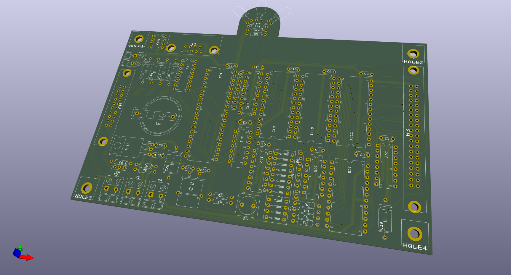

---

## Contents

### In this README

- [What KIUT converts](#what-kiut-converts)
- [Requirements and installation](#requirements-and-installation)
- [Fonts](#fonts)
- [Quick start](#quick-start)
- [The KIUT window](#the-kiut-window)
- [The command line](#the-command-line)
- [Where the files go](#where-the-files-go)
- [The KIUT folder](#the-kiut-folder)
- [License and Originality](#license-and-originality)
  - [Development History](#development-history)
- [Contributing](#contributing)

### Converting and viewing

| Document | What it covers |
|---|---|
| [Schematics](docs/SCHEMATICS.md) | converting Ulticap schematics and symbol libraries: texts and fonts, `.UTSCH` files, libraries, the designator fix, comparing netlists, what can't be converted, and the defects of Ulticap V5.72 that KIUT corrects |
| [Boards](docs/BOARDS.md) | converting Ultiboard boards and libraries: fonts and text ratios, technology, V2/V3 files, what a conversion writes, pads, vias |
| [Viewer](docs/VIEWER.md) | the KIUT Viewer: Ulticap schematics as Ulticap draws them, and their SVG, PNG and PDF export |
| [Settings](docs/SETTINGS.md) | every setting, its default and what it does |
| [The corrected folder](docs/CORRECTED_FOLDER.md) | a design's folders, the corrected copies of its files, and the shared KiCad project |
| [Coming from KIUC or KIUB](docs/COMING_FROM_KIUC_KIUB.md) | for users of KIUC and KIUB: what works differently in KIUT — the programs, the command line, settings, where libraries go, the results |

### File formats

As found by research.

| Document | What it covers |
|---|---|
| [Ulticap SCH](docs/formats/FILEFORMAT_ULTICAP_SCH.md) | Ulticap's ASCII schematics (`.SCH`, `.BLK`), V1.50 to V5.72 |
| [Ulticap UTSCH](docs/formats/FILEFORMAT_ULTICAP_UTSCH.md) | the binary schematics of Ulticap V5 for Windows (`.UTSCH`) |
| [Ulticap LIB](docs/formats/FILEFORMAT_ULTICAP_LIB.md) | the symbol libraries of Ulticap for DOS (`.LIB`) |
| [Ulticap UTLIB](docs/formats/FILEFORMAT_ULTICAP_UTLIB.md) | the symbol libraries of Ulticap V5 for Windows (`.UTLIB`) |
| [Ultiboard DDF](docs/formats/FILEFORMAT_ULTIBOARD_DDF.md) | Ultiboard's ASCII designs (`.DDF`), V2.x to V5.x |
| [Ultiboard LIB, L55 and TEC](docs/formats/FILEFORMAT_ULTIBOARD_LIB_TEC.md) | Ultiboard's compiled shape libraries (`.LIB`, `.L55`) and technology files (`.TEC`) |
| [Conversion map](docs/formats/CONVERSION_MAP.md) | what each Ulticap item becomes in KiCad |
| [Named stubs](docs/formats/NAMED_STUB.md) | Ulticap's single-pin symbols that name a net, and how KIUT converts them |
| [Text model](docs/formats/ULTICAP_TEXT_MODEL.md) | how Ulticap places text: pin numbers and names, labels, attributes |
| [Text model: implementation](docs/formats/ULTICAP_TEXT_MODEL_IMPLEMENTATION.md) | how KIUT renders and converts Ulticap text |

---

## What KIUT converts

**Schematics** (KIUC; [docs/SCHEMATICS.md](docs/SCHEMATICS.md))
- Ulticap ASCII `.SCH` and `.BLK` files, V1.50 through V5.72, single-sheet or hierarchical (the
  sub-sheets are found from the main sheet), to KiCad `.kicad_sch`; `.BLK` files (or a `.SCH` with
  `block_library = yes`) to a KiCad block library
- Ulticap V5.71/V5.72 binary `.UTSCH` files directly — with what Ulticap's own "save as SCH" export
  loses: fills, line widths, ellipses, pie shapes, sheet-level arcs and circles, pin marks, full RGB
  colours and schematic variants
- Ulticap symbol libraries — `.UTLIB` (Windows) and `.LIB` (DOS) — to KiCad symbol libraries
- Wires, buses, junctions, net labels, annotations, free text, symbols, pins, title blocks,
  multi-gate parts and parts with dissimilar gates; every Ulticap attribute kept as a field
- The characters Ulticap drew, the IEC symbols of its DOS font included, in KiCad's own font or any
  installed font
- The known defects of Ulticap V5.72's export and import, corrected where that can be done safely

**Boards** (KIUB; [docs/BOARDS.md](docs/BOARDS.md))
- Ultiboard ASCII `.DDF` files, V2.x through V5.x, to a KiCad `.kicad_pcb` with a `.kicad_pro` built
  from the DDF's own technology (netclasses, design rules, track widths per net)
- Compiled Ultiboard libraries (`.LIB` V4, `.L55` V5) with their technology (`.TEC`)
- Tracks, vias, SMD and through-hole pads, copper zones, the board outline, Ultiboard's layer
  stack-up mapped to KiCad's layers
- V2/V3 staircase traces recovered as diagonals, and their 90° corners chamfered
- A library board and a footprint library `<name>.pretty` with every shape the input defines

**A design** — its schematic and its board together:
- one KiCad project, `<name>_KiCad`, with one `.kicad_pro`, the project libraries
  `<name>.kicad_sym` and `<name>.pretty`, and one settings file for both;
- one designator check for both sides: designators KiCad wouldn't accept as annotated are renamed
  in corrected copies of the schematic *and* the DDF;
- every footprint linked to its symbol, so KiCad's *Update PCB from Schematic* finds them in
  agreement;
- your original files are never written: every correction goes into corrected copies in
  `<name>_corrected`.

Repeated conversions of the same input give identical files. **The KIUT Viewer** shows Ulticap
schematics as Ulticap draws them, and exports them as SVG, PNG and PDF ([docs/VIEWER.md](docs/VIEWER.md)).

[↑ Contents](#contents)

---

## Requirements and installation

- **Python 3.13** or later, with tkinter (the KIUT window)
- **PySide6**, for the viewer only: `pip install PySide6`
- **KiCad 9** or later (its `kicad-cli` for *Compare netlists*)

tkinter comes with the standard Python installer on Windows and macOS; on Linux it is usually a
package of its own:

```
sudo apt install python3-tk
```

Download or clone the repository and run KIUT from its folder; nothing else needs installing.
The command line (`kiut.py`) needs no more than Python itself.

**One settings file comes with KIUT**: `kiut_defaults.ini`, the default settings (*Defaults* in
the window, `--settings default`); change a value there to change a default. Each program writes
its own the first time it has something to keep: `kiut.ini` (the KIUT window's current settings,
read by `kiut.py` too) and `kiut_viewer.ini` (the viewer's), in the KIUT folder, and a design's own
`<name>_kiut.ini` in its output folder. Without them the defaults apply — so unpacking a newer KIUT
over an older one never replaces your settings (only `kiut_defaults.ini`). The settings of KIUC's and KIUB's own windows (`kiuc.ini`, `kiub_gui.ini`)
can be imported: *File → Import old settings…*, offered once when they are found next to KIUT. The
files are read, never changed, and the log lists what was taken.

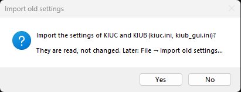

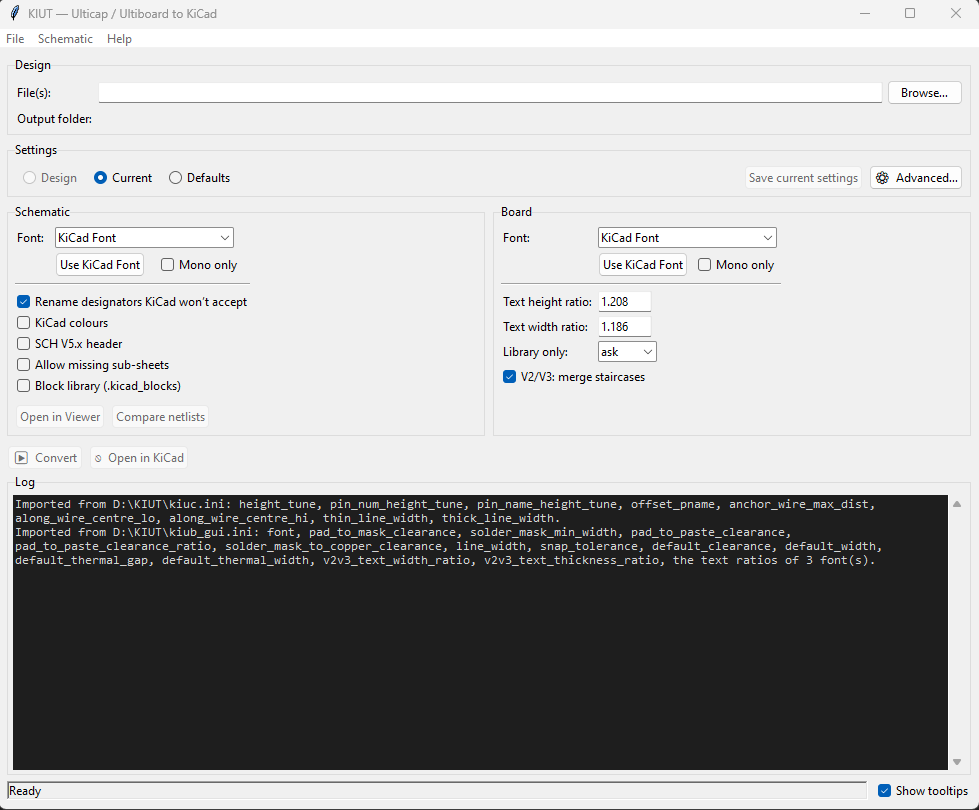

[↑ Contents](#contents)

---

## Fonts

KIUT can write KiCad's texts in any installed font, chosen separately for the schematic and the
board. **KiCad Font**, KiCad's own, is the default and needs nothing installed. The others must be
installed on every computer that opens the KiCad files — KiCad brings no fonts of its own and shows
its own font instead:

| Font | Used for | Where it comes from |
|---|---|---|
| Ultiboard Stroke | board text, closest to Ultiboard | `fonts/UltiboardStroke-Regular.ttf`: install it |
| Ulticap Stroke | schematic text, closest to Ulticap | `fonts/UlticapStroke-Regular.ttf`: install it |
| DejaVu Sans Mono | a monospaced choice for either; also draws the characters KiCad's font lacks | not included: install it separately |
| ISOCTEUR | the viewer's text | not included: an AutoCAD (Autodesk) font, free for personal use; check its licence before commercial use |

> [!IMPORTANT]
> **Boards: use Ultiboard Stroke.** The Ulticap and Ultiboard fonts give the results closest to the
> originals, and the board's text settings in particular (among them the V2/V3 text size and stroke
> estimates) are tuned for the Ultiboard font. Another font can draw the same text larger, and on a
> copper layer a text that grows can touch neighbouring traces or pads: shorts that KiCad's design
> rule check reports. With another font, run the design rule check after converting and lower the
> text ratios where texts on copper come too close.

To install a font:
- **Windows:** right-click the `.ttf` file → **Install** (or **Install for all users**).
- **macOS:** double-click the file → **Install Font** in Font Book.
- **Linux:** copy it to `~/.local/share/fonts/` (or `/usr/share/fonts/` for all users), then run
  `fc-cache -f`.

Then restart the KIUT window or the viewer: both read the list of installed fonts when they start.
A font the settings name that isn't installed stays in the settings, and the window's log says so;
converting, a schematic's Ulticap Stroke or DejaVu Sans Mono is then replaced by KiCad's font, with a
warning, and any other name is written as it is (KiCad shows its own font until it is installed).

[↑ Contents](#contents)

---

## Quick start

```
python kiut_gui.py                       # the KIUT window
python kiut_gui.py design.SCH            # ... with a design opened in it
python kiut.py design.SCH                # the command line: writes design_KiCad/ next to design.SCH
python kiut.py design.SCH design.DDF     # a schematic and its board, into one KiCad project
python kiut_viewer.py design.UTSCH       # the viewer
```

Then open `design_KiCad/design.kicad_pro` in KiCad — or press *Open in KiCad* in the window.

[↑ Contents](#contents)

---

## The KIUT window

```
python kiut_gui.py [<file(s)>]
```

One window for everything KIUT converts. From top to bottom:

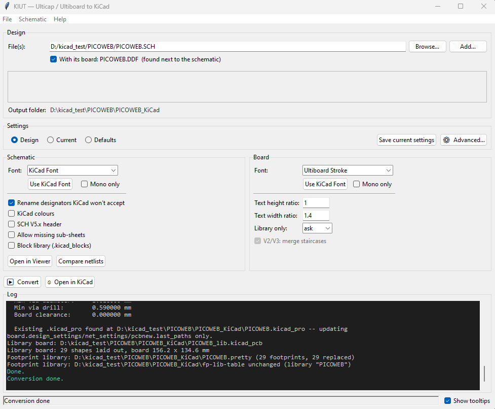

**Design.** *File(s)* takes what `kiut.py` takes (*Browse…*, or typed): a schematic (`.SCH`, `.BLK` or
one `.UTSCH` — for a hierarchy, its main sheet), one or more Ulticap symbol libraries, a board
(`.DDF`), or Ultiboard libraries with their technology. *Browse…* chooses the files, *Add…* adds
more, from the same folder or another. When a schematic's board lies next to it (the same name, in
the same folder), **With its board** converts both together, ticked by default; for anything else it
is greyed out. Choosing a design lists its sheets in the log (the sub-sheets found, a `.UTSCH`'s
sheets, a sub-sheet that's missing). *Output folder* shows where the conversion goes: a design next
to its files, a library into KIUT's library folder (see [Where the files go](#where-the-files-go)).

What can be chosen together:

| Chosen | Converts to |
|---|---|
| a schematic: a `.SCH` (its main sheet), a `.BLK` or one `.UTSCH` | its KiCad project; its board too when one lies next to it (*With its board*) |
| `X.SCH` and `X.DDF` (or `X.UTSCH` and `X.DDF`), same name, same folder | one design: schematic and board in one KiCad project |
| one `.DDF` | the board; a library DDF (shapes only, or components without nets) goes to `Footprints` |
| Ulticap symbol libraries (`.UTLIB`, DOS `.LIB`), one or more, from any folder | `Symbols` |
| Ultiboard libraries (`.LIB`, `.L55`), library DDFs, or both, with at most one `.TEC` | `Footprints`, each its own `.pretty` |
| anything else (two designs, a schematic with a library, a `.TEC` on its own) | refused: the ERROR says why |

The order of the files doesn't matter. An Ultiboard library may be chosen without its `.TEC`:
*Convert* then asks for the technology, once for all the libraries, and remembers the last one
chosen ([docs/BOARDS.md](docs/BOARDS.md#ultiboard-libraries)).

Below *File(s)*, a framed **message block** says what there is to know about the files chosen, in
the colour of the most serious message:
- **ERROR** (red): the files can't be converted as chosen — the block says why, and *Convert* is
  greyed out. A file whose content isn't what its extension says is refused this way too.

  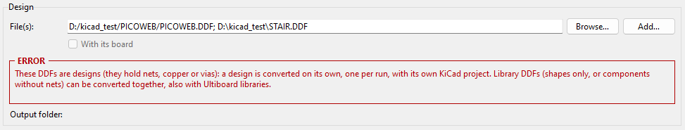

- **WARNING** (amber): they can, with a reservation — several Ultiboard libraries with one
  technology, library DDFs that may be designs, a `<name>_V3.DDF` of an earlier KIUB
  ([docs/BOARDS.md](docs/BOARDS.md)). *Convert* then means going on: nothing more is asked.

  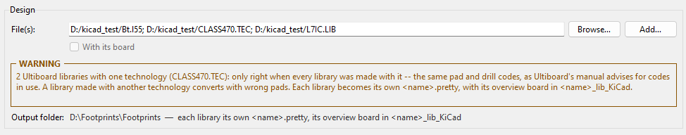

- **NOTE** (blue): worth knowing, for example that a board's schematic is in the same folder.

  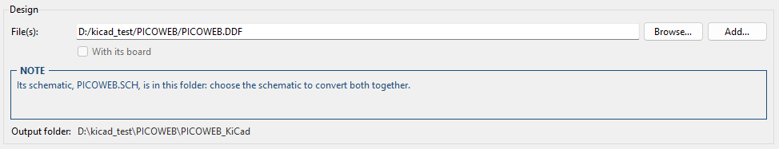

Everything the block says is in the log too.

**Settings.** Which settings the window shows and a conversion uses: **Design** (the design's own,
`<name>_kiut.ini`, written by its first conversion), **Current** (`kiut.ini`: as last used or
changed here) or **Defaults** (the built-in ones). Opening a design takes its own settings when it
has them, else the current ones. Changing a value by hand makes the set the current one: the
selector moves to *Current* and `kiut.ini` is written at once. **Save current settings** saves them
as the design's own. **⚙ Advanced…** holds the settings not in the main window, in two tabs —
*Schematic* (the empirically-tuned values, Ulticap DOS's line widths) and *Board* (board defaults,
geometry, fallback values, the V2/V3 staircases) — with each one's default and suggested range.

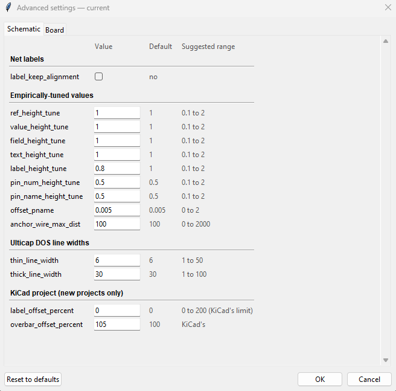

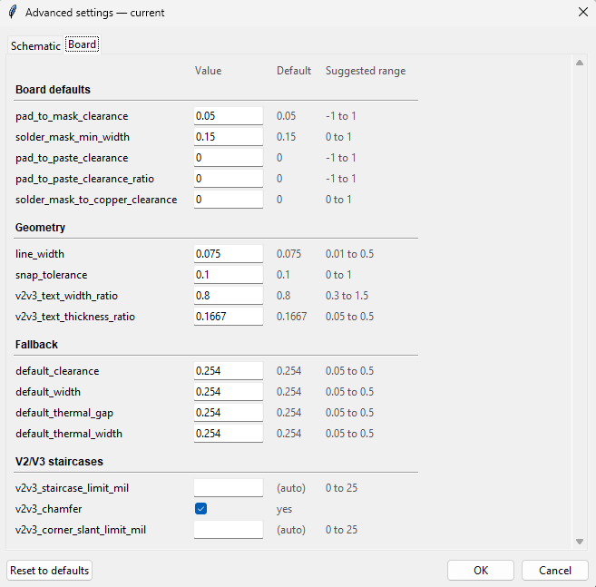


Every setting is explained in [docs/SETTINGS.md](docs/SETTINGS.md); with *Show tooltips* on, a
control's tooltip ends with its place in the settings file, e.g. `[board] font_height_ratio`.

**Schematic** and **Board.** Each has its own **Font** (the installed fonts; *Use KiCad Font* goes
back to KiCad's own, *Mono only* lists monospaced fonts; typing a letter jumps to the fonts starting
with it). The schematic's switches: *Rename designators KiCad won't accept* (`fix_designators`),
*KiCad colours*, *SCH V5.x header*, *Allow missing sub-sheets*, *Block library*. The board's: the
text height and width ratios (remembered per font), *Library only* (`ask`, `yes`, `no`) and *V2/V3:
merge staircases* (greyed out unless the board is a V2/V3 DDF). A section, or a switch, that doesn't
apply to the input is greyed out. The
Schematic section also has:
- **Open in Viewer** — the schematic in the KIUT Viewer;
- **Compare netlists** — after a conversion, the converted schematic's nets against Ulticap's own
  netlist of the design ([docs/SCHEMATICS.md](docs/SCHEMATICS.md#comparing-netlists)).

**▶ Convert** runs the conversion, and **⎋ Open in KiCad** opens the design's KiCad project: with the
KiCad program chosen in *File → KiCad program…*, else the program your system opens `.kicad_pro`
files with (set up by KiCad's installer); only when neither works does the window ask where KiCad's
project manager (`kicad` / `kicad.exe`) is, and remembers it. With several KiCad versions installed
side by side, *File → KiCad program…* chooses the one to use, or goes back to the system's choice.

**File** also holds *Library output folder…*: where library-only conversions go (KIUT's library
folder, `Documents/KIUT` unless chosen; see [Where the files go](#where-the-files-go)).

**Log.** What the conversion reports, coloured by kind (warnings, errors, notes); after a
conversion it is saved to `<output folder>/<name>.log`.

**What the window asks.** The settings decide almost everything; the window asks only what `kiut.py`
asks — files to replace (one question for a schematic and its board), corrected copies that are
out of date, a DDF that may be a library (with `library_only = ask`) — and what needs a person:
an ambiguous record in an exported `.SCH` (the record-integrity dialog,
[docs/SCHEMATICS.md](docs/SCHEMATICS.md#known-ulticap-v572-export-defects-auto-corrected)) and an Ultiboard
library's technology ([docs/BOARDS.md](docs/BOARDS.md#ultiboard-libraries)).

**Menus**
- **File:** *Open…*, *Import old settings…* (KIUC's `kiuc.ini`, KIUB's `kiub_gui.ini`: read, never
  changed), *Save log…*, *Exit*.
- **Schematic:** *Rename designators without converting…* (the designator fix on its own, after a
  confirmation listing the renames), *Review auto-corrected pins…* (after a conversion that corrected
  pin labels), *Dump / Inspect* and *Dump Symbols* (what the schematic holds, in the log and in
  `<name>_sheets.log` / `<name>_symbols.log`).
- **Help:** this README, the settings reference, *About KIUT*. The documents open as web pages in
  your browser: KIUT renders them from the `.md` files in its folder each time, so nothing else is
  needed to read them, also without a connection.

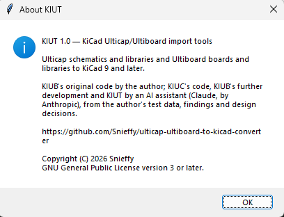

On closing, when a conversion ran and the settings differ from the design's own, the window asks
whether to save them as the design's settings.

[↑ Contents](#contents)

---

## The command line

`kiut.py` takes the files to convert and which settings to use, nothing else: every conversion
setting is in a settings file ([docs/SETTINGS.md](docs/SETTINGS.md)).

| Argument | Description |
|---|---|
| `file(s)` | The files to convert, one kind per run: a schematic (`.SCH`, `.BLK` or one `.UTSCH`), Ulticap symbol libraries (`.UTLIB`, DOS `.LIB`), one board (`.DDF`), or footprint libraries -- Ultiboard libraries (`.LIB`, `.L55`) with their technology, library DDFs, or both -- or a schematic and its board together (`X.SCH X.DDF`, one design: the same name, in the same folder). A name with `*` or `?` is expanded by `kiut.py` itself, so `libs\*.DDF` works on Windows too. |
| `--settings design\|kiut\|default` | Which settings: the design's own `<name>_kiut.ini`, `kiut.ini` (the current ones), or the built-in defaults. Without it: the design's, else `kiut.ini`, else the defaults. The output's first line names them. |
| `--yes` | Answer every question "go on" (existing files replaced; corrected copies out of date: the default answer). Each question is still shown, with its answer. |
| `-q` / `--quiet` | Show nothing and ask nothing (each question takes its default); the report goes to `<output folder>/<name>.log`. |
| `--fix-only` | The designator fix only: the corrected copies of the schematic -- and of its board, given with it -- written into `<name>_corrected`, nothing converted. Not for a board alone: a board is never renamed on its own. |

```
python kiut.py design.SCH                  # a hierarchical design: give its main sheet
python kiut.py design.UTSCH                # design_KiCad/
python kiut.py design.SCH design.DDF       # schematic and board, one KiCad project
python kiut.py design.DDF                  # the board alone
python kiut.py blocks.BLK                  # Documents/KIUT/Blocks/blocks.kicad_blocks
python kiut.py LogicA.UTLIB LogicB.UTLIB   # Documents/KIUT/Symbols/: a .kicad_sym each, one sym-lib-table
python kiut.py shapes.lib design.tec       # an Ultiboard library with its technology: Documents/KIUT/Footprints/
python kiut.py A.LIB B.L55 design.tec      # several, with one technology: asked first; each its own .pretty
python kiut.py libs/*.DDF                  # library DDFs, each with its own technology (* and ? expanded by kiut.py)
python kiut.py design.SCH design.DDF --fix-only
```

A design's first conversion writes its settings, `<name>_kiut.ini`, into its output folder; a later
conversion reads them, and the schematic and the board of one design share them; `kiut.py` never
writes `kiut.ini`. A question reads its answer from the terminal or a pipe; with no answer to read
(a scheduled run) it takes its default and says so. A genuinely ambiguous record in an exported
`.SCH` can't be resolved on the command line: the conversion stops, and the window converts it. Exit
codes: 0 done, 1 refused, cancelled or failed, 2 a wrong command line.

[↑ Contents](#contents)

---

## Where the files go

```
<folder of the originals>/
    <name>.SCH (+ sub-sheets) or <name>.UTSCH, <name>.DDF    your originals: never written
    <name>_corrected/    corrected copies of the originals, under their own names
    <name>_KiCad/        the KiCad project: the schematic, the board, one <name>.kicad_pro,
                         the project libraries <name>.kicad_sym and <name>.pretty,
                         sym-lib-table, fp-lib-table, <name>_kiut.ini, the logs
    <name>_lib_KiCad/    a design's DDF converted as a library only: its library board, <name>.pretty

<your user folder>/Documents/KIUT/
                         KIUT's library folder: every library-only conversion, side by side
    Symbols/             Ulticap symbol libraries: a .kicad_sym and a log each, one sym-lib-table,
                         Ulticap_lib_kiut.ini
    Blocks/              block libraries (a .BLK, or a .SCH with Block library): <name>.kicad_blocks,
                         its <name>_kiut.ini, one design-block-lib-table
    Footprints/          Ultiboard libraries and library DDFs: <name>.pretty, one fp-lib-table, and each library's
                         overview board in <name>_lib_KiCad (its .kicad_pcb, .kicad_pro, log, settings)
```

KiCad treats a `.kicad_pro`, `.kicad_sch` and `.kicad_pcb` as one project only when they share one
name in one folder, so a design's folder and names can't be chosen; to convert a design somewhere
else, copy its files there. A design stays together with what it makes, its own libraries included.
A library-only conversion goes into KIUT's library folder instead, so the converted libraries lie
side by side, ready to be copied to KiCad or added to its library tables. It lies in your user
folder — `C:\Users\<you>\Documents\KIUT` on Windows (`%USERPROFILE%\Documents\KIUT`),
`~/Documents/KIUT` on Linux and macOS — and is created by the first library-only conversion, each
subfolder when it is first needed. Another folder can be chosen in the window (*File → Library
output folder…*, kept in `kiut.ini` for `kiut.py` too) or for one run with the environment variable
`KIUT_LIBRARY_FOLDER`. A folder that can't be written to (a CD, a read-only share) is refused.

Every correction KIUT makes to a design's source files goes into `<name>_corrected`, and every later
conversion reads those copies. The folder is a complete design that Ulticap and Ultiboard open as
it is: copying its files over the originals adopts the corrections. When an original changed since
its copy was made, KIUT asks before converting and offers to redo the corrections; copies you
edited by hand are never replaced unasked. Existing KiCad files are only replaced after asking; the
`.kicad_pro` and the library tables are updated, never replaced. A library already in the library
folder is named with the file it was converted from before you're asked.

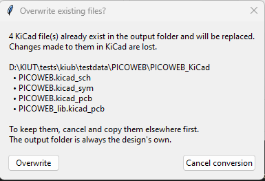
[docs/CORRECTED_FOLDER.md](docs/CORRECTED_FOLDER.md) describes it all in full.

[↑ Contents](#contents)

---

## The KIUT folder

| File or folder | |
|---|---|
| `kiut_gui.py` | the KIUT window |
| `kiut.py` | the command line |
| `kiut_viewer.py` | the KIUT Viewer |
| `kiut/` | the code: `schematic/` (KIUC), `board/` (KIUB), `core/` (what both share), `gui/` (the window), `viewer/` |
| `docs/` | the documentation, its images in `docs/assets/` |
| `examples/` | `blank.UTSCH` (an empty design: the example of [FILEFORMAT_ULTICAP_UTSCH.md](docs/formats/FILEFORMAT_ULTICAP_UTSCH.md)), sample DDFs in `DDF/` |
| `fonts/` | the Ultiboard and Ulticap Stroke fonts |

[↑ Contents](#contents)

---

## License and Originality

This project is licensed under the **GNU General Public License v3.0 (GPLv3)**: see [LICENSE](LICENSE).

This software is an original work. KIUT contains no Ulticap or Ultiboard code, and no part of it
was translated from their programs; no proprietary algorithms or confidential materials were used.
The implementation is based on independent analysis of publicly observable file format behaviour
and the 1997 Ulticap and Ultiboard reference manuals.

### Development History

- **Primary research:**\
  The parsing logic and the format descriptions are derived from the **Ulticap 32-bit DOS and
  Windows 95 — Reference Manual (1997-08-07)** and the **Ultiboard 32-bit DOS and Windows 95 —
  Reference Manual — Appendix A — File Formats (1997-08-15)**, supplemented by extensive empirical
  testing against real Ulticap schematics (V1.50 through V5.72) and Ultiboard DDF files (V2.x
  through V5.x). The formats found are described in the [file format documents](#file-formats),
  with the manuals' errata.
- **Independent logic:**\
  KIUT is an independent Python implementation. Format details the manuals don't document were
  determined by direct observation of real files across the supported version ranges: the binary
  `.UTSCH` and `.UTLIB` files by comparison with Ulticap V5.72's own ASCII export and import, the
  compiled Ultiboard libraries by comparison with the DDF files they were compiled from.
- **Ulticap's own flaws:**\
  The research also uncovered flaws in Ulticap itself — in its V5.72 export, import and library
  handling. KIUT corrects them where it can do so safely, and documents those it cannot
  ([docs/SCHEMATICS.md](docs/SCHEMATICS.md#known-ulticap-v572-export-defects-auto-corrected)).
- **Code and documentation:**\
  KIUB's original code was written by the author. KIUC's code, KIUB's further development and
  KIUT were written by an AI assistant (Claude, by Anthropic), working from the author's test
  data, findings and design decisions. The author supplied the real Ulticap and Ultiboard designs,
  ran every test in Ulticap, Ultiboard and KiCad, and decided how each problem was to be solved.

[↑ Contents](#contents)

---

## Contributing

Contributions are welcome! If you find edge cases in specific Ulticap or Ultiboard versions, please
open an issue or submit a pull request.\
As this project is GPLv3, all derivatives must remain open and free.

[↑ Contents](#contents)
