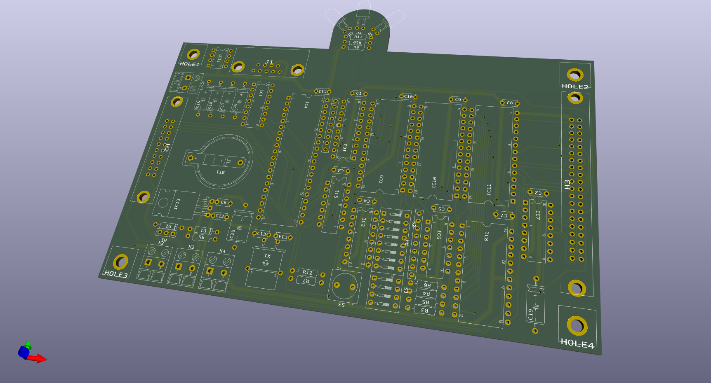
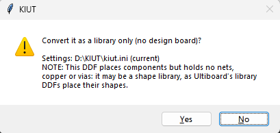
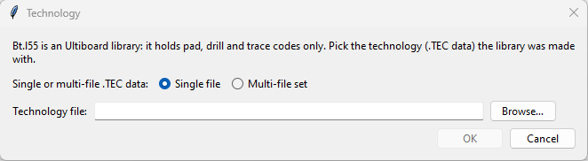
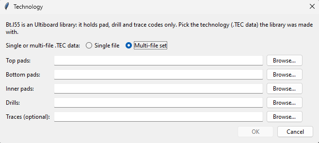

# Converting Ultiboard boards

How KIUT converts Ultiboard boards and libraries to KiCad — the part of KIUT that was published on
its own as KIUB. The KIUT window and the command line are described in the [README](../README.md);
every setting named here in [SETTINGS.md](SETTINGS.md); the DDF format, with the errata of
Ultiboard's 1997 reference manual, in [FILEFORMAT_ULTIBOARD_DDF.md](formats/FILEFORMAT_ULTIBOARD_DDF.md).

> [!NOTE]
> KIUT writes board files KiCad 9 reads. While the design data itself is accurate, KiCad performs a
> one-time update of the file's notation the first time a converted board is opened and saved.
>
> Copper zones need to be filled once the board is opened in KiCad, as only their outline and hatch
> settings are converted: *Edit → Fill All Zones*, or press `B`. Don't forget to save the board.

The software has been tested against many different PCB designs. Even though great care has been
taken to mimic the DDF design accurately in KiCad, small differences are still possible.

---

## Contents

[↑ README contents](../README.md#converting-and-viewing)

- [Inputs](#inputs)
- [The board's settings](#the-boards-settings)
- [Font and text ratios](#font-and-text-ratios)
- [Before a conversion](#before-a-conversion)
- [V2/V3 files and the corrected folder](#v2v3-files-and-the-corrected-folder)
- [Staircases and chamfering](#staircases-and-chamfering)
- [Reference designators](#reference-designators)
- [Ultiboard libraries](#ultiboard-libraries)
- [What a conversion writes](#what-a-conversion-writes)
- [Footprints linked to their symbols](#footprints-linked-to-their-symbols)
- [Board setup](#board-setup)
- [Pads](#pads)
- [Vias](#vias)
- [Sample files](#sample-files)

## Inputs

- **A board**: an Ultiboard ASCII `.DDF` file, V2.x through V5.x. When no extension is given,
  `.DDF` is added. V2.x/V3.x files are first converted to V4.60 (see
  [V2/V3 files](#v2v3-files-and-the-corrected-folder)).
- **Ultiboard libraries**: compiled shape libraries, `.LIB` (V4) or `.L55` (V5), with the technology
  they were made with — one, or several with one technology (see
  [Ultiboard libraries](#ultiboard-libraries)). An Ulticap symbol library, which
  also uses the `.LIB` extension, is told apart by its content and converted as a schematic input
  ([SCHEMATICS.md](SCHEMATICS.md#converting-symbol-libraries)).
- **Library DDFs**: a `.DDF` that holds shapes only, or places components without nets, copper or
  vias (as Ultiboard's library DDFs do) and is converted as a library. It goes into KIUT's library
  folder's `Footprints`, each with the technology it holds; several can be converted in one run, also
  with Ultiboard libraries (see [Ultiboard libraries](#ultiboard-libraries)).
- **With its schematic.** A board whose schematic lies next to it, under the same name, is converted
  together with it: one KiCad project, one designator check, and each footprint linked to its
  symbol (see the README).

[↑ Contents](#contents)

---

## The board's settings

In the KIUT window's Board section, or `[board]` in a settings file ([SETTINGS.md](SETTINGS.md)):

| Setting | In the window | |
|---|---|---|
| `font` | Font | the font of every text on the board; see [Font and text ratios](#font-and-text-ratios) |
| `font_height_ratio`, `font_width_ratio` | Text height ratio, Text width ratio | the text size for the chosen font |
| `library_only` | Library only | `ask`, `yes` or `no`, for a DDF that may be a design or a library (see [What a conversion writes](#what-a-conversion-writes)) |
| `v2v3_staircase_merge` | V2/V3: merge staircases | see [Staircases and chamfering](#staircases-and-chamfering) |
| `tec_split` | — (the technology dialog) | an older Ultiboard library's multi-file technology, on the command line |

*Advanced…* (Board tab) holds the rest. Alter these cautiously — wrong values can give DRC errors:

- **Board defaults**, written into the converted `.kicad_pcb`'s setup or the `.kicad_pro`'s design
  rules: `pad_to_mask_clearance`, `solder_mask_min_width`, `pad_to_paste_clearance`,
  `pad_to_paste_clearance_ratio`, `solder_mask_to_copper_clearance`.
- **Geometry**, how converted geometry looks; safe to adjust for a visual fit, they don't affect
  manufacturability or DRC: `line_width` (lines, arcs and circles the DDF gives no width of their
  own) and `snap_tolerance` (board-outline endpoints closer than this are joined).
- **Fallback** copper values, used only where the DDF doesn't give its own: `default_clearance`,
  `default_width`, `default_thermal_gap`, `default_thermal_width`. Set too aggressively, they can
  trigger DRC clearance violations elsewhere on the board.
- **V2/V3 staircases**: the staircase and chamfer limits, and V2/V3 text sizes (V2/V3 DDFs don't
  store a text's width or stroke).

[↑ Contents](#contents)

---

## Font and text ratios

Choose the font of the converted texts from the board's **Font** list (only monospaced fonts with
**Mono only**), or click **Use KiCad Font** to go back to KiCad's own. The list holds the installed
fonts, with **KiCad Font** first; typing a letter selects the next font starting with it. The
**Text height ratio** and **Text width ratio** (`font_height_ratio`, `font_width_ratio`) are the
empirically-tuned multipliers that make converted text match Ultiboard's own rendering for the
chosen font, suggested between 1.0 and 1.5. They are remembered **per font**: choosing a font fills
in the ratios last used with it. KiCad Font, DejaVu Sans Mono and Ultiboard Stroke start with
known-good values.

> [!IMPORTANT]
> The board's text settings are tuned for the Ultiboard font, **Ultiboard Stroke**. Another font can
> draw a text larger than Ultiboard did; on a copper layer it can then touch neighbouring traces or
> pads — shorts in KiCad's design rule check. With another font, run the design rule check after
> converting and lower the text ratios where texts on copper come too close.

**Ultiboard Stroke**, `fonts/UltiboardStroke-Regular.ttf`, was made to match Ultiboard's own PCB
font. Like any font but KiCad's own, it must be installed on every computer that opens the KiCad
files; how to install one: the README's [Fonts](../README.md#fonts). Ultiboard's own text encoding
is converted to the characters KiCad shows.

[↑ Contents](#contents)

---

## Before a conversion

Before a board is converted, KIUT checks, in order:

1. **An Ultiboard library's technology** (see [Ultiboard libraries](#ultiboard-libraries)).
2. **Design or library.** A DDF that places components but holds no nets, copper or vias may be
   either — Ultiboard's library DDFs place their shapes as components. With `library_only = ask`
   KIUT asks whether to convert it as a library only (the command line's `--yes`: a design).
   Converted as a library, it goes into KIUT's library folder's **Footprints**, as an Ultiboard
   library does (see [What a conversion writes](#what-a-conversion-writes)).

   

3. **A `<name>_V3.DDF` kept by an earlier KIUB** (see below).
4. **The design's corrected folder**: copies out of date are redone after asking (see
   [V2/V3 files and the corrected folder](#v2v3-files-and-the-corrected-folder)).
5. **Reference designators** (see [Reference designators](#reference-designators)).
6. **Existing files** to be replaced: asked.

A library-only conversion needs no corrected folder, designator check or staircase recovery: it
writes no corrected copy, converts no traces and names its components `S1`, `S2`, …

[↑ Contents](#contents)

---

## V2/V3 files and the corrected folder

KIUT never writes a design's original files. A V2/V3 DDF is converted to V4.60, and that V4.60 DDF
is written as `<name>_corrected/<name>.DDF`, next to the original, under its own name — the folder
the schematic's corrections go into as well (the designator fix, for instance). Every conversion
reads each file from `<name>_corrected` when a copy is there, else the original, so the V4.60 DDF
and a DDF with fixed designators build on each other, in either order. The folder's manifest
`_corrected.json` records each original as it was when it was copied, so KIUT notices:

- **An original changed since its copy was made** (also a schematic sheet): the copies are out of
  date, and KIUT asks to **redo from the originals** (the default) or cancel. A redo removes the
  folder's copies; the schematic's corrections are redone on its next conversion.
- **A copy changed since it was written** (edited by hand, e.g. saved in Ultiboard): it is read as
  it is. If a redo would throw it away, the question defaults to Cancel.

The V4.60 copy is made once: the staircase, chamfer and V2/V3 text settings of that conversion stay
until the copies are redone, and the log says so when the copy is used. To convert again with other
V2/V3 settings, remove `<name>_corrected`. Adopting the corrections is copying the folder's design
files over the originals. A file picked inside `<name>_corrected` belongs to the design `<name>`:
its output goes to the parent folder's `<name>_KiCad`. Every DDF file KIUT writes ends in a genuine
blank line, which Ultiboard requires to open a DDF correctly. [CORRECTED_FOLDER.md](CORRECTED_FOLDER.md)
describes the folder in full.

Earlier versions of KIUB replaced `<name>.DDF` itself with the V4.60 conversion and kept the original
as `<name>_V3.DDF`. Converting such a `<name>_V3.DDF` would make it a design of its own: KIUT says
so and asks first (default No) — to convert the design from that original, copy it over
`<name>.DDF` and convert `<name>.DDF`.

The V2/V3 pre-conversion also runs on its own, from the KIUT folder:
`python -m kiut.board.kiub_v2v3 <file.DDF> [<out.DDF>]` writes the V4.60 DDF (`<file>_V4.DDF` by
default); `--help` lists its options. A conversion makes the same DDF in `<name>_corrected`.

[↑ Contents](#contents)

---

## Staircases and chamfering

The V2/V3 format has no diagonal trace: a diagonal is drawn as a staircase of short grid steps. With
`v2v3_staircase_merge = yes` (the default, *V2/V3: merge staircases*), KIUT recovers such staircases
as true diagonal traces; `v2v3_staircase_limit_mil` sets the longest step recovered (empty: the
file's own declared grid step, at most 25 mil). With `v2v3_chamfer = yes`, ordinary 90° trace
corners are chamfered to 45° as well — independently of staircase recovery. The log reports how many
corners were chamfered.

Chamfering trims each leg of a 90° corner by at most the routing grid (25 mil at most;
`v2v3_corner_slant_limit_mil`) and at most half of either leg, and never at the corner nearest a via
of the trace's own net. The trim is also capped by the trace's own width *w* and clearance *c* from
its trace code: at most (2 − √2)·*c* + (1 − √2/2)·*w*, about 0.59·*c* + 0.29·*w* — 9 mil for a
12.5 mil trace with 9.2 mil clearance. With that cap, a chamfer never brings a trace closer to other
copper (a pad or via it was routed around) than the clearance its corner already kept, and a trace
turning at a pad's centre keeps its end inside any pad wider than about twice the trim. Wide traces
therefore keep a sharp inner corner sooner. Closed loops of traces (a ring or frame) are not
chamfered, and staircase recovery is not affected.

[↑ Contents](#contents)

---

## Reference designators

Reference designators that don't end in a digit (e.g. `TP`, `FID`) are taken by KiCad as
unannotated — on the board that is harmless: KiCad's PCB editor accepts them as they are. They
matter when the board is linked to its schematic, which must have the same designators:

- **Converted together with its schematic**, the schematic's designator check decides for both
  (`fix_designators`, [SCHEMATICS.md](SCHEMATICS.md#the-designator-fix)): renamed designators are
  renamed in a corrected copy of the DDF too, and the board is converted from that copy. A board's
  designators that aren't in the schematic (mounting holes, fiducials, …) are never renamed.
- **Converted alone while its schematic is there** (`<name>.SCH`, `<name>.UTSCH` or `<name>.kicad_sch`
  next to the DDF, or `<name>.kicad_sch` in `<name>_KiCad`, any letter case), KIUT lists the
  offending designators and advises converting both together; the question defaults to stopping.
  Once the schematic's fix has written its copy of the DDF into `<name>_corrected`, the board is
  converted from that copy and the question no longer comes up.
- **Without a schematic** the designators are kept, with a note.

[↑ Contents](#contents)

---

## Ultiboard libraries

A compiled Ultiboard library (`.LIB` for V4, `.L55` for V5) holds each shape exactly as a DDF does,
but no technology: a pad refers to a pad code and a drill code whose sizes are defined in the
technology of the design the library was made with. That is why a library converts only with its
technology. In the KIUT window a dialog asks for it, and remembers the last choice:

- **Single file**: one `.TEC` file (Ultiboard V4.60 and later); on the command line, given with the
  library: `kiut.py shapes.lib design.tec`.

  

- **Multi-file set**, the older split layout: **Top pads**, **Bottom pads**, **Inner pads**, **Drills**
  and, optionally, **Traces**. The same pad file may be picked for several pad layers. On the command
  line: the `tec_split` setting.

  

Each file is checked as it is picked (✓/✗, with the reason), and **OK** is available only when every
needed file fits. A table that lists fewer codes than its full range is reported, and KIUT asks
whether to continue with it (the missing codes count as undefined).

**Several libraries with one technology.** Many users keep one technology for all their libraries,
never changing pad codes already in use — as Ultiboard's manual advises for its own libraries —
and use the free codes for their own pads. Such libraries can be converted in one run, with that
technology: the KIUT window's message block warns that this is only right when every library was
made with it (*Convert* then goes on), and `kiut.py A.LIB B.L55 design.tec` asks first. The
technology dialog is asked once; each library is checked against the technology on its own (codes
it uses that the technology lacks are reported for that library), and each becomes its own
`<name>.pretty` with its own overview board (see below). The libraries may come from different
folders. A library that fails doesn't stop the next. A design is different: its DDF
holds its own shapes and technology.

**Library DDFs, several in one run.** A DDF that holds shapes only, or places components without
nets, copper or vias (as Ultiboard's library DDFs do), is a library file: several can be converted
in one run, also together with Ultiboard libraries and their `.TEC` — `kiut.py *.DDF`, or
`kiut.py *.DDF *.L55 design.tec`. Each DDF converts with the technology it holds; the `.TEC` is for
the `.LIB` and `.L55` files only (a `.TEC` with DDFs alone is refused). The DDFs that may be designs
are asked about once, all together ("Convert them all as libraries?"; the window's message block
warns, and *Convert* answers it); with `library_only = yes` nothing is asked, with `library_only =
no` such a DDF can't go with others. A design among them is refused, named: a design is converted
on its own. Two libraries of one name are refused too.

KIUT combines the library and its technology into the shapes and technology of a DDF and converts it
to a library only, so `<name>_lib.kicad_pcb` is the same board the library's source DDF gives. The
log names the library, its version and number of shapes, and the technology files used. The formats
are described in [FILEFORMAT_ULTIBOARD_LIB_TEC.md](formats/FILEFORMAT_ULTIBOARD_LIB_TEC.md).

- Technology in other units than the library (V4 `.TEC` data for a V5 library, or the other way
  round) is converted, as Ultiboard itself converts V4 technology to V5, and the log says so. A
  nonzero value never becomes 0, so pads marked as having no hole keep that mark.
- A library holds shape names of at most 12 characters; the log counts the names of exactly 12
  characters, which may have been shortened when the library was compiled.
- A library slot that does not hold a readable shape is left out and named in the log; a library
  without any readable shape is refused.
- The board clearance (KiCad's `min_copper_edge_clearance`) is a design setting no `.TEC` file
  holds, so the `.kicad_pro` gets KIUT's default clearance.
- When the library's source DDF is still available, converting it is the more faithful route: its
  technology is the one its shapes were made with.

[↑ Contents](#contents)

---

## What a conversion writes

A design's files go into one folder next to it, named after the design, `<name>`; a library's —
an Ultiboard library, or a library DDF — into the **Footprints** folder of KIUT's library folder
(`Documents/KIUT` unless chosen in the window, *File → Library output folder…*; README "Where the
files go"):

| Input | Folder | Files |
|---|---|---|
| A design (a DDF with nets, copper or vias, or placed components) | `<name>_KiCad` next to it | `<name>.kicad_pcb` and `.kicad_pro` (the design), `<name>_lib.kicad_pcb` and `.kicad_pro` (the library board), `<name>.pretty` and `fp-lib-table` (the footprint library) |
| A design's DDF (nets, copper or vias) converted with `library_only = yes` | `<name>_lib_KiCad` next to it | `<name>_lib.kicad_pcb` and `.kicad_pro`, `<name>.pretty` and `fp-lib-table` |
| An Ultiboard library (`.LIB`, `.L55`); a library DDF: shapes only, or components without nets, copper or vias converted as a library | `Footprints` | `<name>.pretty`, listed in the folder's one `fp-lib-table` (the entry naming the library it was converted from); the library board `<name>_lib.kicad_pcb` and `.kicad_pro` in `Footprints/<name>_lib_KiCad`, with its own `fp-lib-table` pointing one folder up |

The `.pretty` folders of every library converted lie side by side in `Footprints`, ready to
be copied to KiCad together; a library already there is named with its source before you're asked
to replace it. The KIUT window also saves its log in the library board's folder, `<name>.log` (so
does `kiut.py -q`). `<name>` is the
input's name — for a file picked inside `<name>_corrected`, the design `<name>` it belongs to. A
DDF's folders can't be chosen. The design's schematic goes into the same `<name>_KiCad`: the `.kicad_pcb`,
the `.kicad_sch` and the one `<name>.kicad_pro` form the design's KiCad project. An existing
`.kicad_pro` is updated, not replaced: the board's conversion sets only its design settings (its
defaults, design rules and rule severities), its net settings, its file name and the PCB editor's
last paths, and keeps everything else, the schematic's settings included; a project file it creates
is the one KiCad 9 starts for a board alone, with these settings in it.

Existing boards (`<name>.kicad_pcb`, `<name>_lib.kicad_pcb`) are only replaced after asking: changes
made to them in KiCad would be lost, so to keep them, cancel and copy them elsewhere first. The
footprints in `<name>.pretty` are replaced without asking.

**Library board.** A DDF holds every shape it defines, placed or not, but its design board holds
footprints only for placed components: a shape the DDF defines but never places would not reach
KiCad. So KIUT also writes the library board `<name>_lib.kicad_pcb`: it keeps the DDF's header and
technology data (the pads need it) and lays out every shape exactly once — in the DDF's own order,
unrotated, on the front side, packed in rows by size with 0.2" between shapes — on a new rectangular
board. How the DDF itself places its shapes does not matter: its components, nets, copper, vias,
power planes, texts and board outline are left out. Each shape becomes component `S1`, `S2`, … with
the shape's name as its value, both texts at the shape's own text positions. The board shows every
shape at a glance — including shapes no design ever used, and faulty ones. A library-only input
without shapes is refused; a design without shapes gets its design board only.

A shape whose pads have no size in the DDF's technology data (see [Pads](#pads)) is marked with a
rectangle and both its diagonals around its outline and pads, on the user layer `KIUB.Check`
(`User.1`), and the log names the shape and pad codes. The mark is part of the footprint, so it also
goes into the footprint library and keeps flagging the footprint there: delete it once the pads are
fixed (on the board, or in KiCad's footprint editor). KiCad takes a layer's colour from the user's
colour theme, not from the board: give `KIUB.Check` a striking colour such as red once in the
Appearance panel, and every library board shows the marks in it. A design board does not mark
shapes and does not name the layer.

**Footprint library.** KIUT writes a KiCad footprint library `<name>.pretty`: one `.kicad_mod` file
for every footprint of the library board, so for every shape the input defines, placed or not (at
the origin, unrotated, on the front side, reference `REF**`, check marks included). With it, a
footprint for a new component is in the library rather than copied from another board. KIUT adds the
library to the folder's footprint library table `fp-lib-table` (created if needed) as `<name>`, with
the path `${KIPRJMOD}/<name>.pretty`, to browse and to place new parts from. The boards' footprints
are not tied to it: they read `Ultiboard:<footprint>`, a library name no table lists, so each
footprint stays the one the board embeds — a design is often edited without exporting its shapes
again, and KiCad's *Update from library* would otherwise replace a footprint with a library entry of
the same name without warning. Tying a design to the library is a deliberate step in KiCad. The same
name is what the schematic's Footprint fields hold. Converting again replaces the library's
footprints of the same name and reports how many; other files in the `.pretty` folder, and other
libraries in the table, are left as they are; a table not laid out as KiCad writes it is left
unchanged, and the log says so. KiCad does not allow `\ / : * ? " < > |` in a footprint name: such a
character becomes `_` in the footprint's name (its value keeps the shape's own name), and the log
lists the renamed shapes; names that would then differ only in letter case get `_2`, `_3`, …

[↑ Contents](#contents)

---

## Footprints linked to their symbols

Each footprint of the board is linked to its symbol in the schematic, as KiCad links them itself,
so KiCad's *Update PCB from Schematic* matches them without re-linking. The links come from the
design's converted schematic in `<name>_KiCad`: a board converted together with its schematic, or
after it, is linked; a board converted before its schematic is not (a note says so; convert it
again). A multi-unit part links to its unit 1; when KiCad moves the link to another of its units,
that unit is kept the next time the board is converted. The schematic's links stay the same when it
is converted again — they depend only on the sheets, the designators and the units — so a board
converted before stays linked; a schematic converted alone says how many of the board's footprints
are still linked and lists the parts on one side only (a renamed designator shows as one on each
side). The board's footprints and the schematic's Footprint fields both read `Ultiboard:<footprint>`,
so KiCad finds nothing to change.

[↑ Contents](#contents)

---

## Board setup

Paper size is derived from the DDF's own board extents and set automatically, A5 up to A0. Solder
mask minimum width defaults to `0.15` mm (`solder_mask_min_width`).

[↑ Contents](#contents)

## Pads

Through-hole pads become an SMD pad plus a separate through-hole pad, both sharing the same
pin/net number. Since the real pad geometry already lives on the SMD pad, the through-hole pad's
own size no longer needs to match it — only the drill diameter matters for connectivity — but
KiCad still requires a through-hole pad's size to exceed its drill size, so KIUT sets it to drill
diameter + 0.01 mm. This construction causes KiCad's DRC to report a "Padstack is questionable (SMD
pad has no outer layer)" warning; KIUT disables that specific warning in the generated
`.kicad_pro`. Separately, KiCad's PCB view will not display an Inner-layer pad if that layer is
otherwise padless on that pad stack (an apparent KiCad bug) — the 3D viewer shows it correctly
regardless. A pad whose pad code has no size in the DDF's technology tables comes out with size 0
(KiCad pins it to 1 µm when loading the file); the conversion log names each shape and pad code
concerned. Zero-diameter drill codes (the SMD-trick sentinel) and NPTH handling for drill-only
codes are DDF-format-level behaviour — see FILEFORMAT_ULTIBOARD_DDF.md
[§10.4](formats/FILEFORMAT_ULTIBOARD_DDF.md#104-drill-codes-and-the-smd-trick) and
[§2](formats/FILEFORMAT_ULTIBOARD_DDF.md#2-technology-data--t-records).

**Pad clearance and the mass pad-clearance reset.** Each pad's clearance, as read from the DDF, is
written directly into that pad's own definition in the KiCad file. In KiCad, a pad's local
clearance override always takes priority over both the board-wide default clearance and any
zone/polygon clearance — so a copper pour using a different clearance than a pad's local value will
still back off to that pad's local value, not the pour's own. If you want a polygon's own clearance
to govern pad clearances as well, all pad clearances need to be forced back to `0` (KiCad's "fall
back to default/polygon clearance" sentinel) after conversion:

1. **Configure the Selection Filter** — bottom-right corner of the PCB Editor — and uncheck
   everything except *Pads*.
2. **Select all pads** — click inside the layout area, then `Ctrl+A`.
3. **Open the Properties panel**, if not already open: *View → Panels → Properties*.
4. **Set clearances to 0** — in the Properties panel's *Overrides* section, set *Clearance
   Override* to `0`.
5. **Re-pour zones** — press `B` to update all copper zones with the new clearances.

[↑ Contents](#contents)

## Vias

Ultiboard allows non-round via shapes; KiCad's standard vias support round shapes only, so every
via is converted to round using the DDF's own annular-ring and pad-size data per layer (F.Cu, B.Cu,
In*.Cu) — see FILEFORMAT_ULTIBOARD_DDF.md
[§10.7](formats/FILEFORMAT_ULTIBOARD_DDF.md#107-known-errata-in-the-1997-reference-manual) for the non-round-via
erratum this addresses.

Ultiboard also accepts vias whose via code lacks a drill or a pad; KiCad does not. A via without a
drill gets a 0.001 mm drill, so its layers stay connected — **tell the manufacturer these holes are
not to be drilled**. A via without a pad gets a pad 0.01 mm larger than its drill, and a via with
neither is left out. The conversion log lists every such via; see FILEFORMAT_ULTIBOARD_DDF.md
[§7](formats/FILEFORMAT_ULTIBOARD_DDF.md#7-vias--v). To mimic Ultiboard, which allowed these holes, the generated
`.kicad_pro` reports "Hole size out of range" as a warning, not an error.

[↑ Contents](#contents)

---

## Sample files

`examples/DDF/` in the KIUT folder holds sample DDF files that show what the conversion does.

[↑ Contents](#contents)
