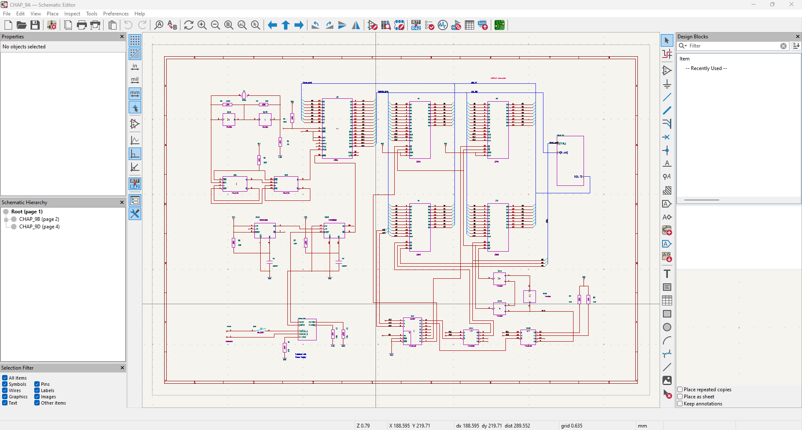
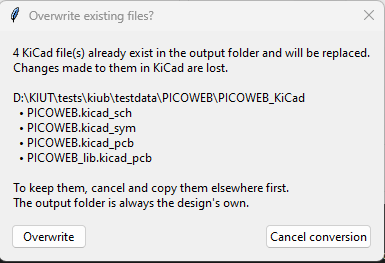
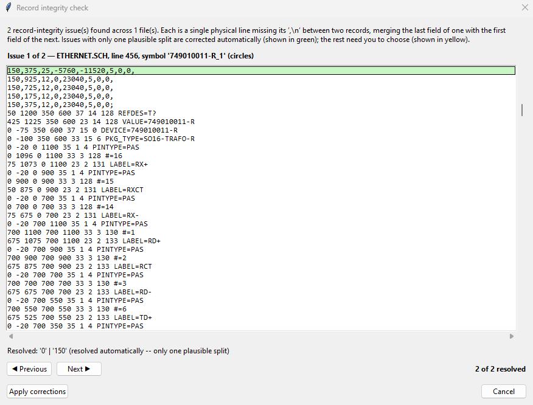
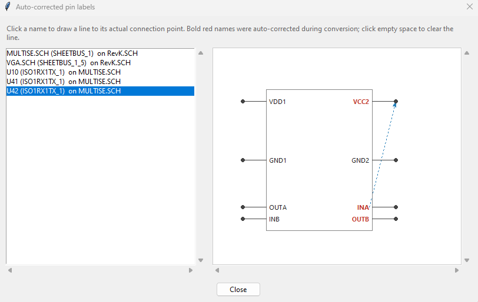

# Converting Ulticap schematics

How KIUT converts Ulticap schematics and symbol libraries to KiCad — the part of KIUT that was
published on its own as KIUC. The KIUT window and the command line are described in the
[README](../README.md); every setting named here in [SETTINGS.md](SETTINGS.md); what each Ulticap
item becomes in KiCad, item by item, in [CONVERSION_MAP.md](formats/CONVERSION_MAP.md).

---

## Contents

[↑ README contents](../README.md#converting-and-viewing)

- [Inputs](#inputs)
- [The schematic's settings](#the-schematics-settings)
- [Before and during a conversion](#before-and-during-a-conversion)
- [The designator fix](#the-designator-fix)
- [Footprints and the board](#footprints-and-the-board)
- [Text characters and fonts](#text-characters-and-fonts)
- [Converting `.UTSCH` files](#converting-utsch-files)
- [Converting symbol libraries](#converting-symbol-libraries)
- [Comparing netlists](#comparing-netlists)
- [Reviewing and inspecting](#reviewing-and-inspecting)
- [Conversion Limitations](#conversion-limitations)
- [Known Ulticap V5.72 Export Defects (Auto-Corrected)](#known-ulticap-v572-export-defects-auto-corrected)

## Inputs

- **A `.SCH` design.** Give its main (parent) sheet: every sub-sheet it refers to is found and
  read, recursively, so sheets of another design can't get mixed in. Each sub-sheet found is
  listed in the log; one that isn't there stops the conversion, unless `allow_missing_sheets = yes`
  (see [Before and during a conversion](#before-and-during-a-conversion)). On the command line,
  extra sheets can still be listed, e.g. sheets in another folder.
- **A `.UTSCH` file** (Ulticap V5.71/V5.72) holds its whole hierarchy: nothing is looked for on disk,
  and the log lists the sheets it holds. One per conversion, never together with `.SCH` files. See
  [Converting `.UTSCH` files](#converting-utsch-files).
- **A `.BLK` file**, or a `.SCH` with `block_library = yes`, becomes a KiCad block library,
  `<name>.kicad_blocks` in the **Blocks** folder of KIUT's library folder (`Documents/KIUT` unless
  chosen, README "Where the files go"): no `.kicad_pro` or `.kicad_wks`, title-block symbols left
  out. It is listed in the folder's `design-block-lib-table` (KiCad 9's table of design block
  libraries) under its name, the file it was converted from as the entry's description, and gets its
  own settings copy there, `<name>_kiut.ini`. A `.BLK` is never hierarchical.
- **Symbol libraries** (`.UTLIB`, DOS `.LIB`), one or several: see
  [Converting symbol libraries](#converting-symbol-libraries).
- **With its board.** A `.SCH` or `.UTSCH` whose `.DDF` lies next to it, under the same name, is
  converted together with its board: see the README and [BOARDS.md](BOARDS.md).

Every file's content is checked against what its extension claims before anything is read: a file
that doesn't match is refused with a clear message, rather than giving an empty conversion.
Problems found while reading are reported with the file, the line and the parts concerned.

**The output** goes into the design's KiCad project folder, `<name>_KiCad`, next to the design's
files (see the README, "Where the files go"). A single-sheet design's `.kicad_sch`, `.kicad_pro`
and `.kicad_wks` are `<name>.…`; a hierarchical design's sheets are named after its sheet files, its
root sheet after the design. Existing `.kicad_sch` files, the project library `<name>.kicad_sym` or
`.kicad_block` entries are only replaced after asking; an existing `.kicad_pro` or `sym-lib-table` —
for example one written for the design's board — is updated, not replaced.

[↑ Contents](#contents)

---

## The schematic's settings

In the KIUT window's Schematic section, or `[schematic]` in a settings file
([SETTINGS.md](SETTINGS.md)):

| Setting | In the window | |
|---|---|---|
| `font` | Font | the font of every text; see [Text characters and fonts](#text-characters-and-fonts) |
| `fix_designators` | Rename designators KiCad won't accept | see [The designator fix](#the-designator-fix) |
| `kicad_colors` | KiCad colours | KiCad's colour theme instead of Ulticap's measured colours; a `.UTSCH`'s full RGB colours are replaced too |
| `v5_header` | SCH V5.x header | for a V5.72 design saved as `.SCH` and mistaken for an earlier version: its version header is set to V5.00 in the corrected copies, so its arcs are read the V5 way (see [Further losses in the export](#known-ulticap-v572-export-defects-auto-corrected)). Not for `.UTSCH` |
| `allow_missing_sheets` | Allow missing sub-sheets | a sub-sheet that isn't there is left out instead of stopping the conversion |
| `block_library` | Block library (.kicad_blocks) | a `.SCH` to a block library. Not for `.UTSCH` |

*Advanced…* (Schematic tab) holds the fine tuning:

- **Net labels.** `label_keep_alignment` (no): keep Ulticap's alignment of a label whose point
  had to move ([Wire labels](#conversion-limitations)).
- **Empirically-tuned values.** The text-height multipliers, one per kind of text, so each can be
  fine-tuned on its own: `ref_height_tune` (references), `value_height_tune` (values),
  `field_height_tune` (the other fields, a symbol's label text, a sheet symbol's name and file),
  `text_height_tune` (free texts), all 1.0: 1.137 matches Ulticap's character size exactly, 1.0
  comes close without pushing texts off their place; `label_height_tune` (0.8) for the texts KiCad
  attaches to a wire (net labels, bus labels, port labels, a pin's wire label), a little smaller,
  as KiCad keeps a label on its wire where Ulticap let it stand free. `pin_num_height_tune` and
  `pin_name_height_tune` default to 0.5, half the Ulticap size, deliberately: KiCad keeps pin
  numbers and names attached to their pin. A settings file of an earlier version with only
  `height_tune` gives its value to each of the five. The same values apply to `.SCH` and `.UTSCH`
  input. The others place pin names and labels.
- **Ulticap DOS line widths** (`thin_line_width`, `thick_line_width`). Ulticap DOS draws a line in
  one of two fixed widths, built into the program: a `.SCH` file only records which of the two a
  line uses, and `ULTIC.SET` doesn't hold them either. The values are in Ulticap units (real mil =
  value ÷ 2). They apply to symbol lines and arcs and to sheet lines from `.SCH` files only; a
  `.UTSCH` file stores each line's own width, which is used as-is. Wires and buses are always drawn
  with KiCad's own project defaults.
- **KiCad project (new projects only)** (`label_offset_percent` 0, `overbar_offset_percent` 105).
  KiCad's own label and overbar offsets, in percent as *Schematic Setup → Formatting* shows them,
  not Ulticap values: written into a project KIUT creates (as KiCad's ratios, the percentage ÷ 100),
  an existing project keeps its own. The label offset takes 0 to 200 only, KiCad's limit: KiCad
  accepts a negative value and saves it, but reads it back as its default 15 % on reopening the
  project, without a word and with the file unchanged -- so KIUT refuses a value outside the limit
  (the default used, with a warning, when a settings file holds one). 0 puts full-size labels
  right on their wire, which keeps their texts from running into neighbouring items. The overbar
  offset has no limit; a negative value draws the bar under the text.

[↑ Contents](#contents)

---

## Before and during a conversion

Before a schematic is converted, KIUT checks it for the known defects of Ulticap V5.72's export
([below](#known-ulticap-v572-export-defects-auto-corrected)), in order:

1. **Hierarchy completeness.** A sub-sheet that isn't there stops the conversion, unless
   `allow_missing_sheets = yes`: then it is left out, and the log says so.
2. **Record integrity.** Records Ulticap glued together are split again. The clear-cut cases are
   resolved by themselves; a genuinely ambiguous one needs a choice only a person can make, so the
   KIUT window shows it — what is wrong, and the choices — before anything is written; the command
   line stops rather than guess.
3. **Reference designators** (see [The designator fix](#the-designator-fix)).
4. **Existing files** to be replaced: asked.

The pin-label override correction and the symbol-name fix for Ulticap V4.91 run during the
conversion, with nothing to decide. Every correction is written to the design's corrected copies in
`<name>_corrected`, never to your originals. For `.UTSCH` input the record-integrity check, the
pin-label correction and the symbol-name fix don't apply: the defects they repair only exist in
ASCII files.

[↑ Contents](#contents)

---

## The designator fix

Ulticap allows reference designators that don't end in a digit (e.g. `TP`, `FID`), which KiCad
treats as unannotated. Multi-part designators like `R1A`/`U2B` are different: the trailing letter
names the gate of a multi-part symbol, and KiCad accepts them as they are.

With `fix_designators = yes` (the default), the offending designators are renamed in corrected
copies of the whole hierarchy — or of the `.UTSCH` file — in `<name>_corrected`, under their
original names, and those copies are converted. When the design's `.DDF` lies next to it, a
corrected copy of the DDF is written too, so board and schematic keep the same designators;
converting the schematic and its board together, the board is converted from that copy in the same
run. With `no`, the design is converted unchanged, with a warning.

- A designator gets the next free number (`TP` → `TP1`), checked against every designator of the
  design and of the DDF.
- A multi-part symbol whose package name has no trailing digit (gates placed as `ICA`, `ICB`, …) is
  renamed once, and every gate keeps its letter (`ICA`, `ICB` → `IC1A`, `IC1B`; in the DDF `IC` →
  `IC1`), so the gates stay one package.
- The copies keep the original line endings and file names; copying them over the originals adopts
  the fix. A `.UTSCH` copy changes only the designators and keeps the original's save time.
- A placeholder designator of the form `!n!` (Ulticap writes one when reading an ASCII design whose
  gate is already taken in its package) is reported but left alone: the original designator isn't
  stored, so it has to be renamed by hand.
- **The log** of the renames: `<name>_corrected/_refdes_log.txt`, with the copies it describes; with
  `fix_designators = no`, `<name>_KiCad/<name>_refdes_log.txt`, next to the converted schematic.

**The fix on its own**, without a conversion: *Schematic → Rename designators without converting…* in
the KIUT window
(a confirmation lists the renames first) or `kiut.py <design> [<design>.DDF] --fix-only`.

[↑ Contents](#contents)

---

## Footprints and the board

Each part's Footprint field names the footprint the board places for it: `Ultiboard:<footprint>`.
With the design's DDF next to it (or its corrected copy), that is the shape the board places for the
part's reference designator. Designs are often never back-annotated, so a schematic's package can
differ from the board's; the board then decides, the schematic's own package is kept as the hidden
field `UC_PKG_TYPE`, and the log lists every such part. Without a DDF, the field is the schematic's
package, named as KIUT names the board's footprints. Board and schematic are linked when the board is
converted (see [BOARDS.md](BOARDS.md#footprints-linked-to-their-symbols)).

**The project library.** `<name>.kicad_sym` holds every symbol the design defines — each `.SCH`
sheet's own definitions, also those no sheet places (a `.kicad_sch` can only hold the symbols it
places); for a `.UTSCH`, the symbols it places. Each is converted exactly as from an Ulticap library.
Where two sheets define one name differently, the later one is kept as `<name>_2`, and the log says
which. A design without symbols (only wires and texts) gets no library. The library is listed in the
project's `sym-lib-table` under the design's name, to browse and place from.

The schematic is deliberately **not linked** to it: placed symbols refer to the library `Ulticap`,
which no table lists, and each sheet keeps the symbols it embeds. A design's symbols can differ from
a library entry of the same name — a design never back-annotated, a symbol changed in one sheet only
— and KiCad's *Update symbols from library* would replace them without warning. To tie a design to
a library afterwards, use KiCad's *Edit Library References*.

[↑ Contents](#contents)

---

## Text characters and fonts

Ulticap for DOS draws texts in its own font, which follows the IBM PC character set (code page 437)
except for eight codes: 176–178 draw nothing, and 219–223 are IEC qualifying symbols used in the
symbols of Ulticap's IEC libraries. KIUT converts `.SCH` and `.BLK` texts to the characters Ulticap
drew, those eight included:

| Code | Code page 437 | Ulticap for DOS, and KIUT's output |
|---|---|---|
| 176–178 | `░ ▒ ▓` | a space |
| 219 | `█` | `⊓` |
| 220 | `▄` | `▷` |
| 221 | `▌` | `≷` |
| 222 | `▐` | `▫` |
| 223 | `▀` | `◁` |

Ulticap V5.71/V5.72 draws texts in Windows fonts, so `.UTSCH` texts are converted as V5.72 stores
them (for one way V5.72 changes texts read from DOS files, see
[Not correctable: V5.72 upper-cases texts](#known-ulticap-v572-export-defects-auto-corrected)).

The text font is KiCad's own by default; any installed font can be chosen instead (the schematic's
*Font*, `font`). Two are worth knowing:

- **Ulticap Stroke**, made from Ulticap's own screen font as Ultiboard Stroke is from Ultiboard's,
  for converted schematics that look as they did in Ulticap: `fonts/UlticapStroke-Regular.ttf`.
- **DejaVu Sans Mono** draws every character KIUT produces. KiCad's own font draws every character of
  these texts except the line-drawing characters 179–218 of the DOS character set (`│ ┤ ╡ … ┘ ┌`) and
  three rare Windows characters (`ˆ ˜ ™`), for which it shows a placeholder box. No original DOS
  design or library examined uses the line-drawing characters; they do turn up in `.SCH` files
  exported by V5.72, where its upper-casing has turned other codes into them.

When either of these two is chosen but not installed, KiCad's font is used and the log says so. A
font must be installed on each computer that opens the KiCad files; how to install one: the README's
[Fonts](../README.md#fonts). Text sizes are set by the fine-tuning heights for every font alike
(KiCad's own font and DejaVu Sans Mono match closely).

[↑ Contents](#contents)

---

## Converting `.UTSCH` files

Ulticap V5.71/V5.72 saves designs as binary `.UTSCH` files, which KIUT reads directly. Where both
exist, converting the `.UTSCH` file is the better choice: it avoids the defects of Ulticap's own
"save as SCH" export ([below](#known-ulticap-v572-export-defects-auto-corrected)), and keeps what
that export loses — filled shapes, line widths, ellipses and pie shapes, sheet-level arcs and
circles, pin clock and inversion marks, and colours in full RGB. The format is described in
[FILEFORMAT_ULTICAP_UTSCH.md](formats/FILEFORMAT_ULTICAP_UTSCH.md).

KiCad has no ellipse or pie shape, so KIUT draws them with KiCad's own curves, each editable as such
in the symbol editor: an ellipse as four Bézier curves (a filled one gets its fill from a shape
without outline beneath the curves, since KiCad fills a Bézier only up to the line between its ends),
a pie as an arc — KiCad fills a filled arc as a pie slice — and a line for its two radii. A round
ellipse is a circle.

**Output file names.** The root sheet, the `.kicad_pro` and the `.kicad_wks` are named after the
`.UTSCH` file itself, as Ulticap's own export names the root. Sub-sheets keep the names stored in the
file, which is what the root's sheet symbols refer to. A character that can't appear in a file name
(e.g. the `/` in a sheet called `A/B`) is written as `_` (`A_B.kicad_sch`). If the `.UTSCH` file's
own name equals one of its sub-sheet names, the root keeps its stored name instead, and a warning
says so. Converting a design from its `.SCH` files and from its `.UTSCH` file therefore writes
largely the same KiCad files, into the same `<name>_KiCad`: the second conversion asks before
replacing the first's.

**Schematic variants.** A `.UTSCH` design can hold schematic variants: document variants (e.g.
`DEFAULT` and `VARIANT1`), of which Ulticap shows one, and per part one or more symbol variants (e.g.
`SYMVAR1`, `SYMVAR2`), each with its own values and serving one or more document variants — the way
Ulticap's part properties show them. A part can also be left out of a document variant. KiCad has no
schematic variants, so KIUT converts the variant Ulticap shows — the one marked visible in Ulticap's
variant settings — and keeps the rest of the data in the same file:
- every part gets the shown variant's values (reference, value, device, package, and their
  positions), exactly as Ulticap draws the design;
- where another variant gives a part other values, those are kept as hidden fields named
  `UC_<tag>_<symbol variant>_<document variant>`, e.g. `UC_VALUE_SYMVAR2_VARIANT1`, at the
  position of the shown text; values equal to the shown ones are not repeated;
- a part left out of the shown variant (Ulticap hides it) is kept, so its connections and data are
  not lost, but marked *do not populate*, excluded from the BOM and from the board, with a field
  `UC_VARIANT_<document variant>` = `not fitted`; a part left out of another variant only gets that
  field.

The log names the converted variant, the other variants and the parts not fitted in the shown one.
To convert another variant, make it the visible one in Ulticap and save the design. A design
without variants converts as before.

**Not for `.UTSCH` input:** `v5_header` and `block_library` (neither applies).

[↑ Contents](#contents)

---

## Converting symbol libraries

KIUT converts Ulticap symbol libraries to KiCad symbol libraries: `.UTLIB` files, written by the
Windows versions, and `.LIB` files, written by the DOS version. The two are told apart by their
content, not their extension — and so is an Ultiboard `.LIB`, which is converted as a board input
([BOARDS.md](BOARDS.md#ultiboard-libraries)). Each library becomes `<name>.kicad_sym`, with a log
`<name>.log`, in the **Symbols** folder of KIUT's library folder (`Documents/KIUT` unless chosen in
the window, *File → Library output folder…*), wherever the libraries come from, and is listed in the
folder's `sym-lib-table` under its own name, the file it was converted from as the entry's
description. Every Ulticap library converted later goes into the same folder and table, and the
table's other entries are kept; a library of the same name already there is named with its source
before you're asked to replace it. Each `.kicad_sym` is complete on its own: to use one library
elsewhere, copy its `.kicad_sym` and add it in KiCad (*Preferences → Manage Symbol Libraries*).
Block libraries go into the library folder's **Blocks** folder. Libraries are converted on their
own, never together with a design; a design's own symbol library stays with the design, in
`<name>_KiCad`. A library symbol holds the same data as the symbol Ulticap
makes of it when a design uses it, and KIUT converts it with the same code as a design's symbols, so
a symbol placed from the converted library looks as it does in a converted design. Sheet and port
symbols are written as ordinary symbols.

For a `.UTLIB`:

- **Names:** each KiCad symbol is named after the symbol's device keyword, as Ulticap names it in a
  design (`PART\SO`). KiCad's symbol names cannot hold `\`, `/` or `:`, so these become `_`
  (`PART_SO`); the log lists every name changed. A second symbol with a name already taken gets `_2`
  (`_3`, …) and a warning.
- **Device:** the `UC_DEVICE` field holds the device name the symbol shows (`PART`), which Ulticap's
  own import of a library loses — it keeps the keyword only.
- **Case:** texts keep their case. Ulticap V5.72 upper-cases a library's texts when it imports the
  library or places one of its symbols; the library itself does not.
- **Non-homogeneous parts:** a part whose gates have different drawings becomes one KiCad symbol
  with one unit per gate, as in a converted design. Some library symbols also hold a drawing of the
  whole package, named after the device, beside its gate types: it becomes a symbol of its own
  under the device's name, and the joined gate types get `_2`, as for a DOS library (below); the log
  reports each.
- **Misattached texts:** some library symbols carry a label of the drawing as a second pin name, or
  as a net name on the symbol itself. A pin keeps its first name; the others become plain texts at
  their own positions. Each case is reported in the log.

For a DOS `.LIB`:

- **Names:** each KiCad symbol keeps the library's name for it, with `\`, `/` and `:` replaced by `_`.
- **Characters and arcs:** texts get the DOS font's characters and arcs are drawn the DOS way, as for
  a DOS design (see [Text characters and fonts](#text-characters-and-fonts)).
- **Non-homogeneous parts:** a DOS library stores such a part as gate types (`DEV/1`, `DEV/2`). They
  become one KiCad symbol with one unit per gate, named after the device, as in a converted design.
  Where the library also holds a symbol of the device's own name — the whole package in one drawing
  — the joined symbol gets `_2` (`DEV_2`), and the log says so.

For both:

- **Value:** the symbol's `VALUE`, which Ulticap places with the part — even a `?`, and whatever value
  the library gives it. A symbol without one gets its `DEVICE` as Value, at `DEVICE`'s position and
  visibility, and its `UC_DEVICE` field is hidden, so every KiCad symbol has a Value. A multi-unit
  symbol made of gate types has the device's name (`DEV`) as Value and `UC_DEVICE`.
- **Labels:** a multi-unit symbol draws its `TXT` labels as plain texts of its units, each gate type
  its own at its own position; a single-unit symbol keeps them as `UC_TXT` fields, hideable per
  placed part (see [Ulticap attributes in KiCad](#conversion-limitations)).
- **Field positions:** every field keeps the position the library gives it when a symbol is placed
  in KiCad (KiCad's automatic field placement leaves it alone).
- **Colours and font:** `kicad_colors` and the schematic's font apply as for a design.

A `.UTLIB` symbol may use every drawing object of the symbol editor — lines, polylines, arcs,
rectangles, ellipses, pies and polygons, filled or not; they convert as in a design.

A library that cannot be read — a damaged file, or an object of a kind never seen — is reported
with the symbol where reading stopped, and nothing is written for it but its log; the other
libraries are converted (the command line's exit code is then 1). The formats are described in
[FILEFORMAT_ULTICAP_UTLIB.md](formats/FILEFORMAT_ULTICAP_UTLIB.md) and [FILEFORMAT_ULTICAP_LIB.md](formats/FILEFORMAT_ULTICAP_LIB.md).

[↑ Contents](#contents)

---

## Comparing netlists

*Compare netlists*, in the KIUT window's Schematic section after a conversion, checks the converted
schematic against Ulticap's own netlist of the design — net by net, the pins on each net, the net
names ignored:

- **KiCad's netlist** is made by KiCad's `kicad-cli sch export netlist` into
  `<name>_KiCad/<name>.net`. `kicad-cli` is looked for next to the KiCad program the window uses,
  then on the PATH, then where KiCad installs it; when it can't be found or fails, the window asks
  for a KiCad `.net` file instead.
- **Ulticap's netlist** is `<name>.NET` (any letter case) next to the design's files, as Ulticap
  writes it; when it isn't there, the window asks for it. A netlist Ultiboard exported from the board
  is not used: it can hold nets the schematic doesn't.
- **Renamed designators.** Designators the designator fix renamed (`UX` → `UX1`) are read in
  Ulticap's netlist as renamed, so they compare as the same part; the report and the log name them.
- **The report** goes to `<name>_KiCad/<name>_netlist_compare.txt`; its counts are shown in the log,
  nets missing on either side as warnings.

[↑ Contents](#contents)

---

## Reviewing and inspecting

**Review auto-corrected pins…** (Schematic menu) is available after a conversion that corrected one
or more pin-name/number overrides
([Pin name/number pointing to the wrong pin](#known-ulticap-v572-export-defects-auto-corrected)). It
lists every corrected symbol, with a live diagram of the selected one showing what was wrong and what
it was corrected to. Click a pin name to draw a line to its actual connection point; *Show pin
numbers* adds the pin numbers (for a multi-gate part, only that gate's).

**Dump / Inspect** and **Dump Symbols** (Schematic menu) show what the schematic holds — its parsed
contents, or every symbol with its attributes (useful for finding title-block symbols and the like) —
without converting it; the corrected copies are read when there are some. The text goes to the log
and, when the output folder is there, to `<name>_sheets.log` or `<name>_symbols.log`.

[↑ Contents](#contents)

---

## Conversion Limitations

The following limitations are known. Most are inherent differences between the Ulticap and KiCad
data models that cannot be resolved by the converter. This list is non-exhaustive.

For a complete overview of what each Ulticap item becomes in KiCad, item by item for `.SCH` and
`.UTSCH` input, including what is not carried over, see [CONVERSION_MAP.md](formats/CONVERSION_MAP.md).

**Pin names and numbers**\
Ulticap allows pin names and pin numbers to be moved relative to the pin. KiCad fixes their
positions: pin names always appear at the inner end of the pin, pin numbers always above it.
As a result, visible pin names or numbers may overlap or run outside the symbol shape after conversion.

KiCad also cannot hide individual pin names: it hides either all of a symbol's pin names or none.
A symbol that mixes hidden and visible pin names in Ulticap therefore shows all of them in KiCad.

**V5.72 graphical data loss**\
When a V5.72 binary Ulticap file (`.UTSCH`) is saved as a `.SCH` file, some graphical information
is lost. This is a rendering issue only and does not affect any electrical properties:
- Filled objects are no longer filled.
- Object line thickness changes.
- Arcs in symbols no longer display correctly, and are further altered with each subsequent
  "Save as SCH" operation.

Converting the `.UTSCH` file itself avoids all of these (see [Converting `.UTSCH` files](#converting-utsch-files)).

**Sheet size**\
Converted sheet sizes are sometimes larger than expected, due to how Ulticap stores boundary
information in the SCH file.

**Unconnected pin indicators**\
KiCad always displays a small circle at unconnected pin ends. This is a visual artefact only.
Invisible power pins will show this circle in the KiCad editor but it will not appear when
printing or exporting the schematic. These pins are deliberately placed off-grid to prevent
unintended connections with wires passing through them.

**Wire-to-bus entries at the same coordinates**\
When more than one wire connects to the same bus entry point, Ulticap joins those wires into
a single net and connects them to the bus as a single entry. KIUT converts this correctly, but
KiCad keeps them as separate wire-to-bus entries. The electrical result is equivalent, but
the schematic no longer reflects the original Ulticap layout exactly.

**Bus naming: vector vs. group buses**\
KiCad requires two different notations for a bus name depending on its kind: a numbered range
like `D[0..7]` is written verbatim, but a bus that groups arbitrarily-named signals (e.g. a set of
otherwise unrelated control lines) must be wrapped as `{NAME}`. Ulticap has no equivalent notation
of its own — its LABEL=NAME text is always unwrapped, regardless of which kind of bus it names.
KIUT resolves this automatically: a single, shared per-project table decides which form each bus
needs, and every place that name is used — the bus label itself, the hierarchical label, the
sheet pin, and the `bus_alias` — is generated from that same table, so they can't end up
disagreeing with each other.

**Off-grid schematics**\
Converted schematics occasionally end up off-grid. This almost always originates from the
source SCH file, where the schematic itself was already off-grid. It can be corrected in KiCad:
1. Set the default grid to 50 mil (mandatory first step).
2. Select the entire schematic.
3. Right-click and choose **Align items to grid**.

**Title block placement**\
An Ulticap title block can be placed anywhere on a sheet. KiCad only allows a title block
attached to one of the four sheet corners. As a result, the KiCad title block is hidden and
the entire Ulticap title block is placed on the sheet as a symbol. The KiCad title block fields
are still populated with their corresponding Ulticap values, but not all Ulticap title block
fields have a KiCad equivalent.

**Local power nets**\
Ulticap supports local power nets: when a sheet uses signals such as VCC and GND without module
ports, those signals are automatically made global by the Ulticap netlist tool. When a module port
exists, the names remain local to the sheet. KiCad has no equivalent of this behaviour — power
declarations are always global. As a result, every converted SIGNAL attribute becomes part of a
global net. (This matches V5.72's own netlisting behaviour, confirmed at 100% netlist match — see
[A note on Ulticap V4.91](#a-note-on-ulticap-v491) for how V4.91 itself differs.)

**Multi-gate (multi-unit) symbols**\
A symbol whose Ulticap symbol declaration sets `PARTS` > 1 represents a physical part containing
multiple identical gates (e.g. a hex inverter or dual decoder), each placed as a separate component
instance whose REFDES ends in a letter (`U10A`, `U10B`, …) with pin numbers overridden to show just
that gate's own numbers. KIUT converts this to KiCad's native multi-unit mechanism: the trailing
gate letter is stripped from the REFDES (KiCad derives it back from the unit number), and every
unit the part declares — not just the ones actually placed in the design — is defined in the KiCad
library symbol, with unplaced units' pin numbers derived directly from the symbol declaration. This
means a design that only uses some gates of a multi-gate part (leaving the rest spare) converts
correctly, and KiCad's own `missing_unit` ERC rule (severity: warning) will correctly flag the
unused gates for review, rather than staying invisible.

**Parts with dissimilar gates (non-homogeneous parts)**\
Ulticap draws a part whose gates differ (the 7423: two different gates in one package; a relay's
coil and contacts) as one symbol per gate type, with `DEVICE=<device>/<n>` (`7423/1`, `7423/2`),
`GATE1` for the gate type's first gate letter and `PARTS` for its number of gates. KIUT joins a
device's gate types into **one** KiCad symbol (`7423`) with one unit per gate — unit 1 is gate A,
unit 2 gate B, and so on — each unit with its own gate type's drawing and pins. A placed gate
becomes a unit of its package: `U2A` and `U2B` become `U2` unit 1 and `U2` unit 2. Hidden power
pins (`SIGNAL=`) are common to all units. The designator check does not flag these designators.
The same comes from a `.UTSCH`, where Ulticap V5.72 stores such a device as one shape with one gate
drawing per gate type.

Only a `DEVICE` value of the form `<device>/<n>` marks a gate type in a DOS `.SCH`. A `/` elsewhere
in a symbol name (e.g. `CONN/90°` with `DEVICE=CONN-90`) is part of an ordinary name and is
converted as such. Ulticap V5.72's own `.SCH` import, however, reads **any** symbol name with a `/`
as a gate type and splits a designator ending in a letter into package and gate (`J1A` becomes
gate A of `J1`, or gets a placeholder designator `!n!` when that gate is taken). KIUT warns about
such parts when converting a `.SCH` and converts them unchanged.

**Multi-part symbols with visible power pins**\
Some Ulticap symbols are split into multiple parts (units) — op-amps are a common example — with
a visible power pin attached to each unit. KiCad's convention is to place power pins on a single
unit of a multi-part symbol. Converting these symbols as multiple units therefore produces a power
pin on every unit, and KiCad's ERC reports an unconnected-pin error for each one that isn't wired.
KiCad does support non-interchangeable units, where each unit can carry a different set of pins,
but KIUT keeps a power pin on every unit rather than moving it to just one, to avoid the
connectivity issues that consolidating it onto a single unit would introduce. These ERC errors can
be safely ignored.

**Named-stub power symbols**\
Ulticap allows a single-pin symbol to connect to a named net without a drawn wire, through its
WIRELABEL attribute. KiCad has no direct equivalent. See [NAMED_STUB.md](formats/NAMED_STUB.md) for a
full description of how KIUT handles this pattern and what to be aware of in the converted output.

**Subsheet symbol shapes**\
Subsheet symbols in Ulticap can have any shape. KiCad always draws subsheet symbols as rectangles.

**Ulticap attributes in KiCad**\
Attributes with a KiCad equivalent are converted: `REFDES` to Reference, `VALUE` to Value,
`PKG_TYPE` to Footprint, the subsheet name and file to Sheetname and Sheetfile. Some others are
turned into KiCad structure instead of fields: `PARTS` into the units of a multi-unit symbol,
`SIGNAL=` into hidden power pins that join their net by name, pin types, names and numbers into
the pins themselves. Every other attribute — `DEVICE`, `PINSWAP`, user attributes, SPICE
attributes, title-block entries — becomes a KiCad field named `UC_` followed by the Ulticap tag
(`UC_DEVICE`, `UC_SPICEAGEPARAMS`, …), shown or hidden as in Ulticap. Removing the `UC_` prefix
gives the original tag; a tag a symbol carries more than once is numbered (`UC_TXT_1`,
`UC_TXT_2`). A text drawn inside a single-unit symbol (`TXT`, e.g. a part's marking code) is such a
field too, so every placed part shows or hides it as in Ulticap. A multi-unit symbol (a quad gate, a
part whose gates differ) draws its shown `TXT` labels (the "&" of an AND gate) as plain texts of its
units instead: KiCad's fields belong to the whole symbol, with one position for every unit, so only
a unit's own drawing can place each gate's label where Ulticap draws it. Power symbols get only
their net name and their SPICE pin data.

Each placed part carries its own fields, and KiCad shows those; its Value is its own `VALUE`. The
library symbols embedded in the schematic carry the symbol definition's attributes as their
defaults, by the same rules as a converted library: the reference prefix (`U`, `D`, …), the
footprint, every other attribute as a `UC_` field at the definition's position and visibility,
placeholder entries included, and a Value — the definition's `VALUE` (even a `?`), or, where it has
none, its `DEVICE`, at `DEVICE`'s position and visibility, with the `UC_DEVICE` field then hidden. A
symbol exported from the schematic to a KiCad library (KiCad's "Export Symbols to Library"; parts
cannot be placed from the embedded library directly) therefore starts with what the Ulticap symbol
defines; unwanted entries can be removed there.

SPICE attributes that belong to a pin (`SPICE#`, the pin's position in the SpiceAge device line,
and `SPICEAGEPIN`, its SpiceAge pin name) are collected into one hidden field per attribute, as
pin number and value: `UC_SPICEAGEPIN` `1:P1 2:P2`, `UC_SPICE#` `1:1 2:2`. The values are
Ulticap's own, untranslated; KiCad's simulator fields are not filled in.

**Names attached to a symbol**\
A net name can only be given in Ulticap by a wire label on a wire or bus, or by a pin's own net
name. A label-like text that belongs to a symbol instead — a `LABEL1`, a symbol-level
`UT_NETNAME`, or a `LABEL`/`WIRELABEL` placed away from the symbol's pins — names no net, and
Ulticap's own netlist ignores it, even when it is drawn next to a wire. KIUT converts such a text
into plain KiCad text at the same place (a hidden one is left out). Unlike in Ulticap, the text no
longer moves with its symbol, and deleting the symbol leaves the text behind.

**A pin's own net name**\
A pin of an ordinary symbol can carry a net name (in a `.SCH` file a `WIRELABEL` at the pin), which
names the net the pin is on. KIUT keeps the pin's own name and adds a KiCad net label with that net
name at the pin's connection point.

**Wire labels**\
An Ulticap wire label has two points: its text's anchor, and its point of connection on the wire,
which the text can be moved away from. A KiCad label has one point, both where its text starts and
where it connects. KIUT puts it on the label's own wire at the anchor's position along that wire, so
the text stays where Ulticap drew it. Where that isn't possible -- the anchor lies beyond the end of
the wire, or further than `anchor_wire_max_dist` from it, or the point would sit on an unrelated wire
crossing there -- the label goes to the end of the wire or to its point of connection, and its text
is put on the side of that point Ulticap drew it on: a text the user moved left of its connection
point is right-justified. `label_keep_alignment = yes` keeps Ulticap's alignment instead (the text
then possibly on the other side of the point). Across the wire, a centred text is moved above or
below it as in Ulticap. KiCad lifts a label's text off its wire in proportion to its size (the
project's *label offset ratio*): a project KIUT creates gets `label_offset_percent` (0 %, KiCad's
own 15 %), so full-size labels sit on their wire, and `overbar_offset_percent` (105 %, KiCad's
123 %) for the overbars; labels have their own size setting, `label_height_tune`.

[↑ Contents](#contents)

---

## Known Ulticap V5.72 Export Defects (Auto-Corrected)

The limitations above are inherent differences between the two programs' data models. The items
below are different in kind: they are defects in how Ulticap V5.72 itself saves a file, found by
comparing real exported schematics against what the original design actually contains. KIUT
detects each of these automatically and, where it safely can, corrects them without any action
needed — this section exists so a discrepancy noticed later isn't mistaken for a new bug.

**Pin name/number pointing to the wrong pin**\
Some symbols — both ordinary components and subsheet blocks — come out of V5.72 with a pin's
`LABEL`/`WIRELABEL`/`#` override silently mismatched to a *different* pin on the same symbol. The
override's own display position stays correctly anchored next to the right pin (which is why
Ulticap's own editor, and the KIUT Viewer, still show it correctly), but the coordinate meant to
identify *which* pin it electrically belongs to points at the wrong one — so the connection itself
was wrong even though nothing looked wrong. KIUT detects this from the override's own display
position: a pin name normally lines up with its own pin, so a name whose connection point names
another pin, while lining up with exactly one pin, is moved to that pin. Lining up can also be a
coincidence — a symbol may draw its pin names away from their pins, one of them in line with a
different pin. A name already sitting on a pin's connection point is therefore only moved when
the pins' names are shuffled among themselves (every pin still ends up with one name); a move
that would leave two pins' names on one pin is not made. KIUT corrects the KiCad output and the
sheet's corrected copy in `<name>_corrected`, so the corrected design carries the fix into Ulticap
too; the original stays as it was. *Review auto-corrected pins…* shows exactly what was found,
symbol by symbol. A `.UTSCH` file cannot hold this mismatch: there a pin's name and number belong
to the pin itself, not to a stored coordinate, so `.UTSCH` input needs no correction. The
mismatches come from the export: one design's `.SCH` export needed corrections on five components
that its `.UTSCH` file did not.

**Missing record separator (`,\n`)**\
Occasionally a `Pins` or `Circles/Arcs` line in the `*S` shape definition is missing its trailing
`,\n` separator entirely, silently gluing two records together with no error from Ulticap itself —
confirmed to drop a trailing record and shift every subsequent field. KIUT detects and corrects the
clear-cut cases automatically, in the sheet's corrected copy; a genuinely ambiguous split needs a
choice only a person can make, so the KIUT window presents it and the command line stops rather
than guess (see [Before and during a conversion](#before-and-during-a-conversion)).

**Template copies added by V5.72's import**\
When V5.72 reads an old (DOS) design, it gives every placed part a copy of each text its symbol
defines, next to the part's own text — also where the part had moved, hidden or replaced that
text. The copy then sits at the symbol's default position, shown, and V5.72 draws a code twice,
shows one the design had hidden, or shows the symbol's code next to the part's own. The copies
remain in the `.UTSCH` file and in its `.SCH` export. KIUT, and its viewer, keep only the part's
own entry, as in the original design: an entry equal to the symbol's in position, value and
visibility is dropped where a part carries more entries of that attribute than its symbol defines.
Designs created in V5.72 itself never carry more, so their texts are untouched.

**Texts and net names changed by V5.72's import**\
Reading an old (DOS) design, V5.72 also alters some texts, and the `.UTSCH` file and its `.SCH`
export keep the result:
- a free text rotated by 180° or 270° (Ulticap for DOS draws it upside down) is stored as a
  horizontal or vertical text with the same anchor, so it ends up on the other side of its anchor;
- of two net names on one wire, only the first in the file is kept;
- every text is turned into upper case.

Converting the DOS `.SCH` file avoids all three. KIUT writes a 180° or 270° free text as readable
text covering the same area (KiCad never draws schematic text upside down); the viewer draws it
upside down, as Ulticap for DOS does.

**Space in a symbol name breaks Ulticap V4.91**\
A space in a `*S`/`*C` symbol name causes V4.91 to fail opening the file with a disk-read error,
even though V5.72, this converter, and KiCad all handle it fine. KIUT replaces the spaces with
underscores in the design's corrected copies (`<name>_corrected`), consistently between the `*S`
definition and every `*C` placement referencing it, so the corrected design opens in every Ulticap
version; the KiCad symbol names follow (`MY PART` becomes `MY_PART`). Nothing else changes, and the
link with the board is unaffected: a DDF holds the designator, the value and the package of a part,
never its schematic symbol name.

**Sub-sheet filename doesn't match its `FILE=` tag**\
Two distinct V5.72 "save as SCH" defects produce the same symptom — a sub-sheet reference that
can't be resolved to an actual file:
- When the original hierarchical design uses non-DOS-8.3 subsheet filenames, the filenames V5.72
  actually writes for the subsheets can end up not matching the `FILE=` tags recorded in the root
  sheet; with long sheet names, the export writes wrongly named files and records throughout,
  needing manual correction before the files can be used at all.
- Re-saving a `.SCH` that's already been opened in V5.72 sometimes adds a second dot between the
  filename and its extension, or a second `.SCH` extension (e.g. `SHEET2..SCH` or `SHEET2.SCH.SCH`
  instead of `SHEET2.SCH`) — observed so far only on sub-sheets of a hierarchical design.

Neither has a reliable automatic fix — there's no safe way to infer which actual file was meant.
KIUT's hierarchy-completeness check says a sub-sheet is missing and stops, unless
`allow_missing_sheets = yes` (the sub-sheet's content is then simply absent), rather than silently
converting an incomplete design. The fix is manual: edit either the saved filenames or the `FILE=`
tags in the root sheet so they agree. Converting the `.UTSCH` file instead avoids the problem
altogether.

A related note: the `*R` record at the top of each `.SCH` file names that sheet's calling sheet,
and Ulticap accepts any value there, even a blank one. KIUT doesn't rely on it: the root of a
hierarchy is the sheet that no other sheet refers to.

**Further losses in the export**\
Comparing V5.72's `.SCH` export with the `.UTSCH` file it was made from shows more that the export
drops or alters. None of it affects connectivity, and converting the `.UTSCH` file avoids all of it:
- line widths (a symbol line of pen width 12 or more is written thick, anything thinner thin),
  fills, and colours outside Ulticap's 16-colour palette (written as the nearest palette colour);
- sheet-level arcs and circles (left out entirely), ellipses (written as circles), and pie shapes
  (written as plain arcs, at the wrong place and size);
- symbol arcs: the export writes each arc's sweep in the opposite direction, in whole degrees. KIUT
  turns it back for a file marked as V5 (`v5_header = yes`, the window's *SCH V5.x header*), which
  is exact for a file exported once; every further read-in and export moves the arc again, and that
  cannot be undone. Symbol outline coordinates are rounded toward zero to an even number (up to
  2 mil out);
- pin marks: a clock mark, and an inversion bubble on an input or output pin, are left out; so is
  the bus mark on a sheet symbol's pin;
- ellipses of zero width or height in a symbol: Ulticap draws nothing for them (its symbol editor
  doesn't show them either), but the export writes each as a small circle, usually in a malformed
  record that the record-integrity check repairs. The circle then shows up in the converted
  symbol; the `.UTSCH` conversion leaves such ellipses out;
- a thick solid symbol line from a DOS `.SCH` file that has been through V5.72 (read in and
  exported again) comes back as a thin, unfilled rectangle 12 units high around the line; thick
  dashed lines stay thick lines. Converting the original DOS file keeps the thick line.

**One export change does affect connectivity: an attribute keyed `LABEL` on a wire**\
In V5.72 a wire is named by its net name only; an attribute the user adds to a wire under the key
`LABEL` is plain text, and V5.72's own netlist ignores it. The export, however, writes a wire's net
name *and* such an attribute the same way, as `LABEL=…`, and in a `.SCH` file that is a net name:
V4.91's netlist uses it, and reading the `.SCH` back into V5.72 turns it into the wire's net name. So
after an export, that wire's net is named — or merged with another net of the same name — where the
`.UTSCH` design left it unnamed. KIUT converts each file as its own Ulticap netlist reads it: from the
`.UTSCH` file the attribute is plain text, from the exported `.SCH` a net label.

**Not correctable: V5.72 upper-cases texts**\
V5.72 stores texts in upper case — when it reads a DOS `.SCH` file, when it imports a library, and
when a symbol is placed from a `.UTLIB` library (the library itself keeps the case). Its upper-casing
follows the Windows character set, in which some codes of the DOS font are lower-case letters: those
become other codes, which the DOS font draws differently. Code 228, which Ulticap for DOS draws as
`Σ` (a Windows `ä`), becomes 196 (`Ä`); `90°` (code 248, a Windows `ø`) becomes `90Ø`. The codes
219–223 of the IEC qualifying symbols pass unchanged, but V5.72's Windows fonts draw them as letters
(`Û Ü Ý Þ ß`). The original code cannot be told from the stored one, so KIUT converts a `.UTSCH`
file's texts as V5.72 stores and draws them. Converting the original DOS file keeps the characters
Ulticap for DOS drew.

### A note on Ulticap V4.91

The items above are defects in what V5.72 *writes*; this one is about what happens when the
resulting (corrected) files are *read back into V4.91* — worth knowing so a difference there isn't
mistaken for a KIUT defect either. V4.91 uses its own, older net-naming rules, which can produce a
netlist that genuinely differs from what V5.72 (and this converter's own KiCad output, verified at
100% netlist match against V5.72) produces for the exact same design — confirmed directly by
comparing real V4.91-generated netlists against the original. Two examples: V5.72 merges every
same-named `GND`/`VCC`-family symbol into one global net regardless of module-port structure, while
V4.91 only does that when *no* module port exists for that name, correctly keeping a locally-ported
net separate; and V4.91 disambiguates a sub-sheet net name that collides with, but isn't
electrically the same as, a parent-sheet or global name by appending `/N`, which can reject a
name-only match across sheets that don't have a properly matching port structure on both ends,
where V5.72 merges on the name alone. This is V4.91 behaving as it always has, not a defect in the
corrected files or the conversion — when a design was originally authored in V5 and reached this
converter through V5's own "save as SCH" export (as opposed to being a genuinely V4-native design),
there is no earlier "true V4-native" version of it to compare against; V4.91's differing netlist
output is simply what its older, still-correct-for-its-era rules produce when reading V5-authored
data.

[↑ Contents](#contents)
