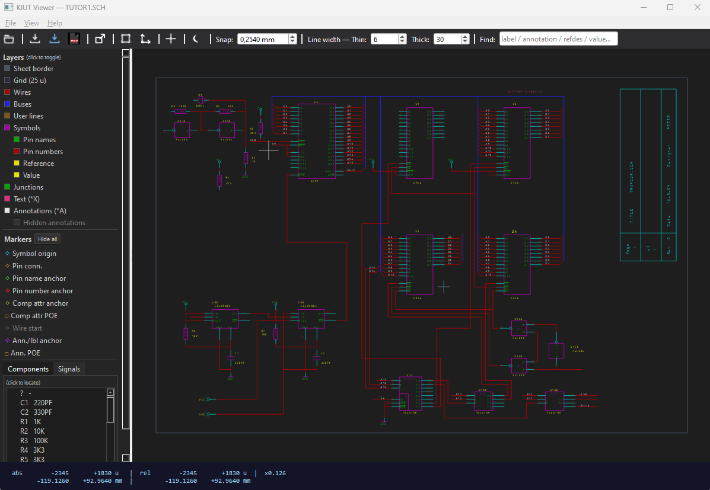
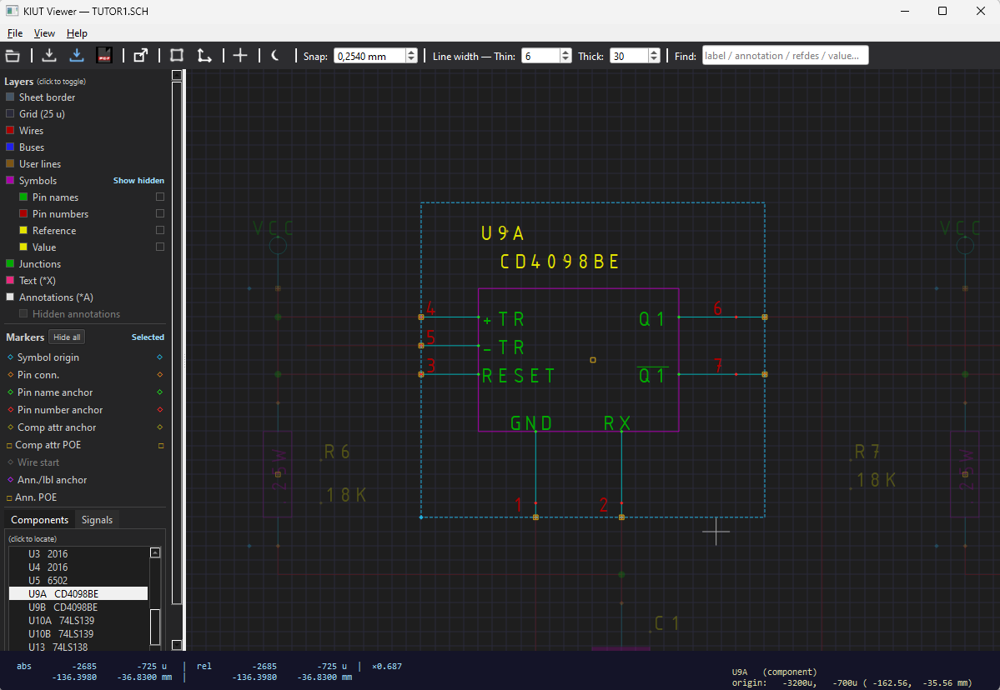
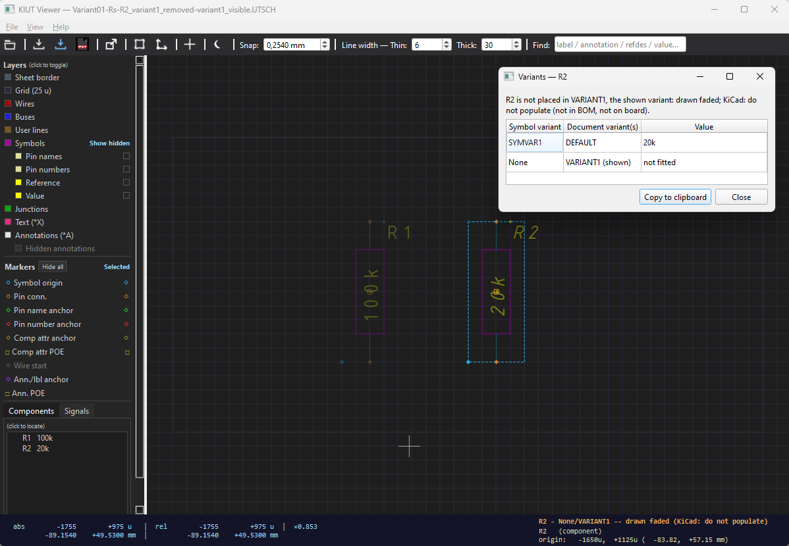
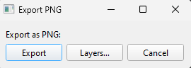
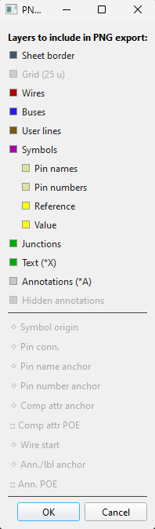
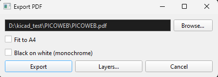
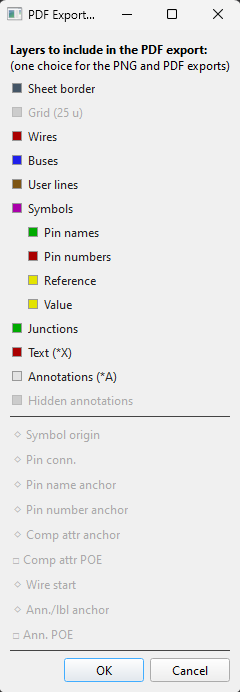

# The KIUT Viewer

The KIUT Viewer shows Ulticap schematics — `.SCH`, `.BLK` and `.UTSCH` files — as Ulticap draws
them, without converting them first, and exports them as SVG, PNG and PDF. It is a program of its
own, next to the KIUT window; nothing it does changes a file or a conversion.



---

## Contents

[↑ README contents](../README.md#converting-and-viewing)

- [Starting it](#starting-it)
- [Finding your way](#finding-your-way)
- [Layers](#layers)
- [Selecting](#selecting)
- [Export](#export)
- [Line widths](#line-widths)
- [Fonts](#fonts)
- [Its settings file](#its-settings-file)

## Starting it

```
python kiut_viewer.py                    # File → Open… to choose a design
python kiut_viewer.py design.SCH         # a .SCH design: give its main sheet
python kiut_viewer.py design.UTSCH
```

- From the KIUT window: **Open in Viewer** (Schematic section) opens the design's schematic — its
  corrected copy when there is one, as a conversion reads it (see
  [CORRECTED_FOLDER.md](CORRECTED_FOLDER.md)).
- **File → Open Recent** lists the last ten designs opened; *Empty Recent Files List* clears it.
- **Open in KIUT…** (toolbar) starts the KIUT window with the design open in it, to convert it.
- The viewer needs PySide6 (`pip install PySide6`); without it, it says so and stops.

The viewer shows exactly what the file it opens stores, and never writes a file. The KIUT window
decides which file that is: a design's corrected copy when there is one — where a conversion has
set the V5 header for `v5_header = yes` (*SCH V5.x header*) — else the original as it is.

[↑ Contents](#contents)

---

## Finding your way

**The canvas.** Mouse wheel: zoom, centred on the cursor. Right or middle drag: pan. **F** (or *Fit
sheet*): the whole sheet in view; *Jump to sheet origin* (toolbar): the sheet's 0,0. **C** (or
*Crosshair*): a crosshair across the whole window. **Space** sets a relative origin at the cursor:
the status bar then shows the cursor's position from there as well. **Snap** (toolbar) sets the step
the cursor's readout snaps to, in mm (`free`: unsnapped; **+**/**-** step through it); it is a
reading aid and never changes the file.

**The background.** *White/Black* (toolbar) switches between Ulticap's own screen colours (black
background, each object in the colour the file gives it) and a white background with one fixed
colour per kind of object — the palette the exports use, chosen to be legible on white.

**Sheets.** For a hierarchical design the **Sheets** panel shows every sheet, at every level — for a
`.SCH` design its sheet files, for a `.UTSCH` the sheets it holds, under their stored names. The
sheet on screen is highlighted; click any other to go there. **Double-clicking** a sheet symbol on
the canvas enters its sheet; **B** goes back to the sheet shown before.

**Components and Signals.** Two tabs below the Sheets panel: *Components* lists every real part as
`REFDES   VALUE` (mounting hardware, sheet symbols and power symbols left out), *Signals* the
`SIGNAL=` pin groupings per part, with their pin numbers. Click an entry to zoom to it.

**Find.** The toolbar's *Find* field searches labels, annotations and the parts' designators and
attribute values (not pin numbers), as you type; step through the matches with the arrow keys or the
mouse wheel, each zoomed to and highlighted, and press Enter to jump to one.

**View** menu: *Side pane* hides or shows the panels; *Schematic info…* gives the current sheet's
counts of symbols, parts, wires, junctions and its grid; *Show tooltips* turns the hover tips off
(on by default); *Reading messages…* lists what reading the design's files said (below). **Help →
KIUT Viewer documentation** opens this document as a web page in your browser; **Help → Shortcuts &
Layers…** lists the keys and panels in the viewer itself. **Esc** clears a highlight; **Q** quits.

**Reading messages.** What reading a design's files has to say — a symbol pin off its wire entry
point, a sub-sheet that can't be found — the viewer keeps to itself: it prints nothing, and the
status bar says how many there are. *View → Reading messages…* lists them, with the file and line.
They change nothing in the drawing; a conversion's log says the same.

[↑ Contents](#contents)

---

## Layers

The **Layers** panel shows or hides each kind of object: sheet border, grid, wires, buses, user
lines, symbols — and under them pin names, pin numbers, reference and value — junctions, free texts
(`*X`) and annotations (`*A`). It is a display filter only: the file doesn't change.

**Hidden texts.** Like Ulticap, the viewer leaves out texts the file stores as hidden. They can be
shown, in italic:
- **for one symbol:** select it (left click). A *Show hidden* column appears, with a square in the
  row's colour on the Pin names, Pin numbers, Reference and Value rows; click a square to show that
  group's hidden texts. Only the selected symbol's hidden texts are drawn — they can sit far from
  their symbol, inside a neighbouring one, and the dimmed rest of the sheet makes clear what belongs
  to the selected one. The squares keep their setting when another symbol is selected;
- **for annotations:** the *Hidden annotations* row under Annotations.

Other hidden attributes (device, package, user and SPICE attributes, …) stay hidden.



**Markers**, at the bottom of the Layers panel, are inspection aids — the anchors of symbols, pins,
pin names and numbers, attributes, wires and annotations, and their points of entry — off by
default in every export. *Hide all* / *Show all* mutes or restores exactly the markers that were on. While a symbol is
selected, a *Selected* column shows or hides each marker kind for that symbol alone, useful for
telling overlapping markers apart; it keeps its setting from one symbol to the next.

[↑ Contents](#contents)

---

## Selecting

**A symbol.** Click it: it is highlighted, the rest of the sheet dimmed, and the status bar names it.
**Right-click** it (without moving the mouse — a right-drag pans) for its menu; where parts overlap,
a submenu per part.

**A detached text.** A symbol's text drawn away from the symbol — a moved pin name, or a symbol-level
net name next to a wire that looks like a label but names no net — can be clicked: it selects its
symbol, the status bar says what the text is, and a dotted line shows where it belongs.

**Schematic variants.** In a `.UTSCH` design with schematic variants the viewer, like the converter,
shows the variant Ulticap shows ([SCHEMATICS.md](SCHEMATICS.md#converting-utsch-files)). A part left
out of that variant is still drawn, faded and with its texts in italic. Clicking a part, the status
bar shows its shown variant as `<reference> - <symbol variant>/<document variant>: <value>`
(`R1 - SYMVAR1/DEFAULT: 10k`), or `None` for a part left out (`R2 - None/DEFAULT -- drawn faded
(KiCad: do not populate)`). The part menu's *Variants* entry (greyed out in a design without
variants) opens a table of all the part's variants — symbol variant, the document variants it
serves (the shown one marked), and its value, `None` for the variants it is left out of — under a
line saying whether the part is placed in the shown variant; a button copies it to the clipboard.



[↑ Contents](#contents)

---

## Export

*File → Export as SVG…, PNG…, PDF…*, or the toolbar's three export buttons. For a hierarchical
design each asks first: **Current sheet** or **All sheets**; SVG export of a one-sheet design goes
straight to saving the file (it has no options). *All sheets* writes one file per
sheet, next to the design, each named as the converter names that sheet's `.kicad_sch` (for a
`.UTSCH`, after its stored sheet names); a long PNG or PDF export shows its progress and can be
cancelled between sheets. Every export uses the viewer's line widths, fits the sheet's content, and
never includes a selection.

| | SVG | PNG | PDF |
|---|---|---|---|
| **For** | editing, scaling, the web | documents, slides, quick sharing | printing, archiving |
| **Kind** | vector | image, 300 dpi | a page, rendered at 150 dpi |
| **Colours** | the export palette, on white | Ulticap's screen colours, on a dark background | the export palette, on white; or **Black on white** (monochrome) |
| **Page** | the sheet's content | the sheet's content | the sheet's content, or **Fit to A4** (portrait or landscape, as the sheet is) |
| **Layers** | the layers shown on screen | chosen with **Layers…** (grid and markers off unless chosen) | chosen with **Layers…**; never the grid or the markers |

- **SVG** keeps every layer as a layer of its own (Inkscape layers), shown or hidden as on screen,
  with hidden annotations on a layer of their own, in italic; opened in a web browser, a small panel
  in the file switches its layers on and off. Texts name the ISOCTEUR font, so the SVG shows best
  where ISOCTEUR is installed.
- **PNG** and **PDF** share one layer selection — *Layers…* in their export dialogs, which names
  the export it was opened from — remembered for the next export, independent of what the screen
  shows. The PDF's own dialog also takes the file name (*Browse…*).









- A file that is open in another program (a PDF in a PDF reader) can't be written: the viewer says
  so, and the export can be repeated once it is closed.

[↑ Contents](#contents)

---

## Line widths

The toolbar's **Thin** and **Thick** set how thick the viewer draws lines, on screen and in every
export: thin for thin symbol and sheet lines, wires and pin stubs, thick for thick symbol and sheet
lines and buses; both set the junction size. They are in Ulticap units (even values, 2–400; real
mil = the value ÷ 2), and default to Ulticap DOS's two fixed symbol line widths, 6 and 30. They are
the viewer's own settings: they never change a conversion, which has its own
(`thin_line_width`, `thick_line_width` in [SETTINGS.md](SETTINGS.md)).

[↑ Contents](#contents)

---

## Fonts

The viewer draws every text in **ISOCTEUR**, an ISO 3098 engineering-lettering font that closely
matches Ulticap's own DOS lettering. ISOCTEUR is not part of KIUT: it is an AutoCAD (Autodesk) font,
free for personal use — check its licence before commercial use — and must be installed for the
closest rendering (how: the README's [Fonts](../README.md#fonts)). Without it another font stands
in, so texts look different and can sit slightly off where they are aligned right or centred; a
message at start says so, until *Do not show this message again* is ticked. Three IEC symbols of
the DOS font (`⊓ ≷ ▫`, codes 219, 221 and 222) are not in ISOCTEUR and are drawn by another font.
The KiCad output does not depend on the viewer's font: a conversion uses the schematic's own *Font*.

The viewer draws a free text rotated by 180° or 270° upside down, as Ulticap for DOS does; and like
the converter, it leaves out the copies of symbol texts that Ulticap V5.72's import adds
([SCHEMATICS.md](SCHEMATICS.md#known-ulticap-v572-export-defects-auto-corrected)).

[↑ Contents](#contents)

---

## Its settings file

The viewer keeps its settings in `kiut_viewer.ini` in the KIUT folder, written the first time it has
something to keep — opening a design, changing a setting, closing it; until then, and without it,
its defaults apply. Nothing in it changes a conversion.

| Section | Holds |
|---|---|
| `[viewer_layers]` | the layers shown on screen |
| `[viewer_export_png]` | the layers of the PNG and PDF exports |
| `[viewer_theme]` | the background: `dark` or `light` |
| `[viewer_recent]` | the recent files |
| `[viewer_line_widths]` | Thin and Thick |
| `[viewer_snap]` | the snap step |
| `[viewer_tooltips]` | Show tooltips |
| `[viewer_notices]` | the messages not to show again |

Until KIUT 1.0 the viewer was KIUC's, and kept these sections in KIUC's `kiuc.ini`. When
`kiut_viewer.ini` isn't there yet and `kiuc.ini` lies next to it, the viewer copies its own sections
from there, once; `kiuc.ini` itself is left as it is.

[↑ Contents](#contents)
