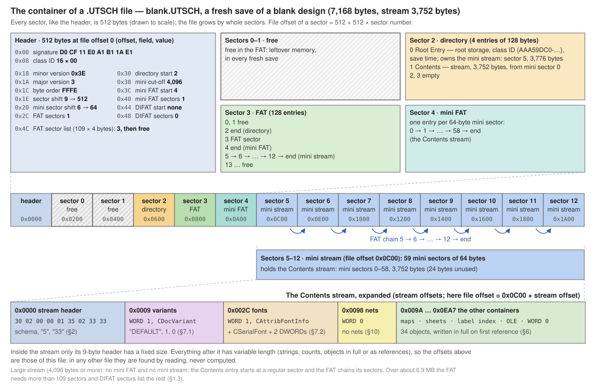
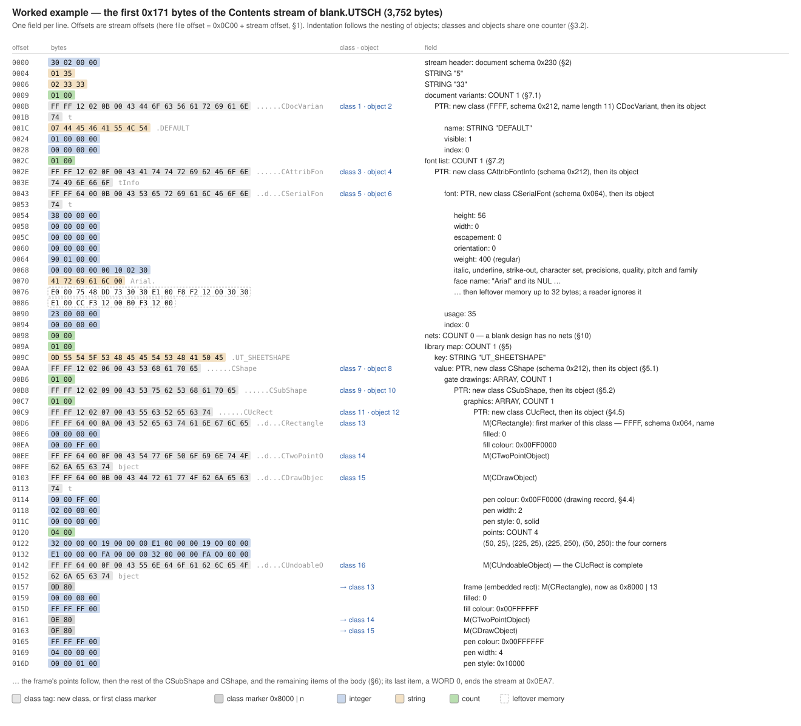
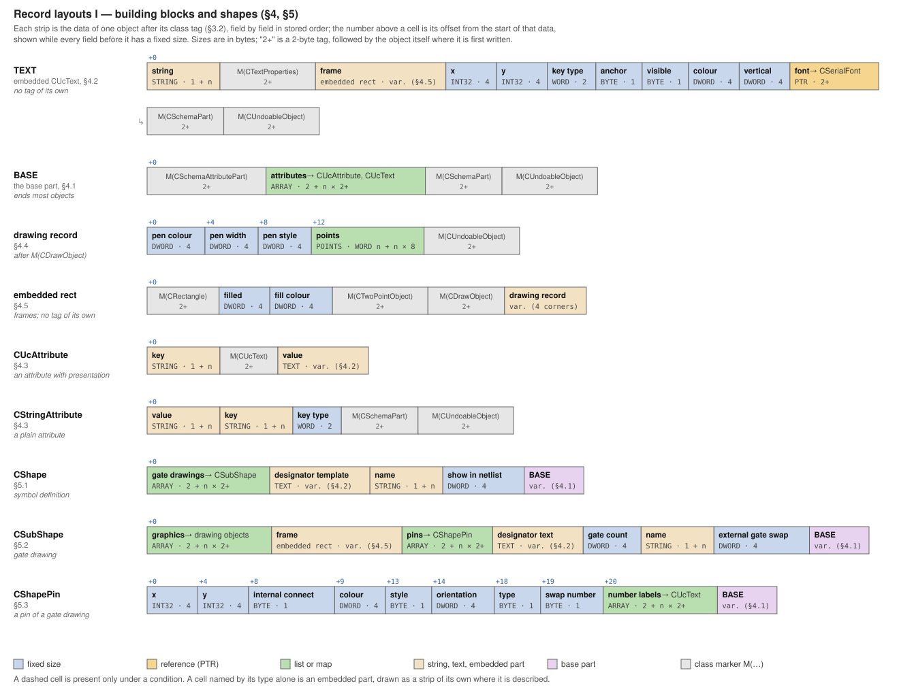
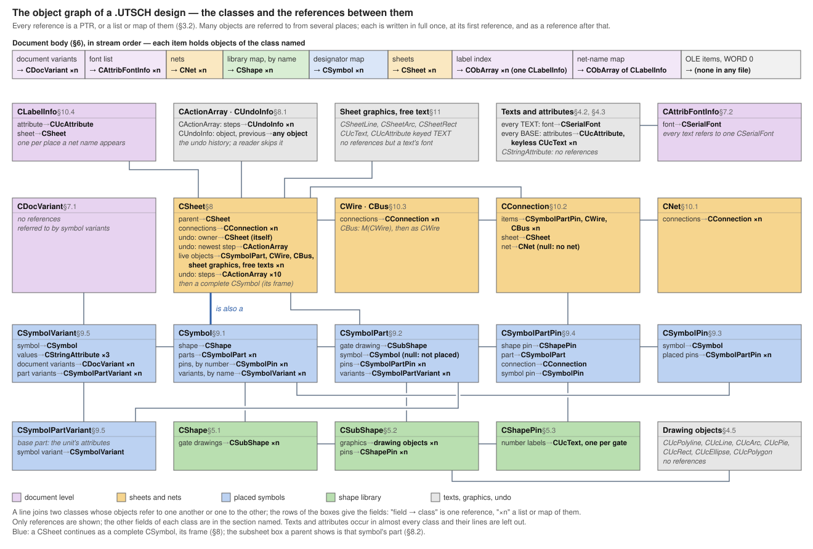
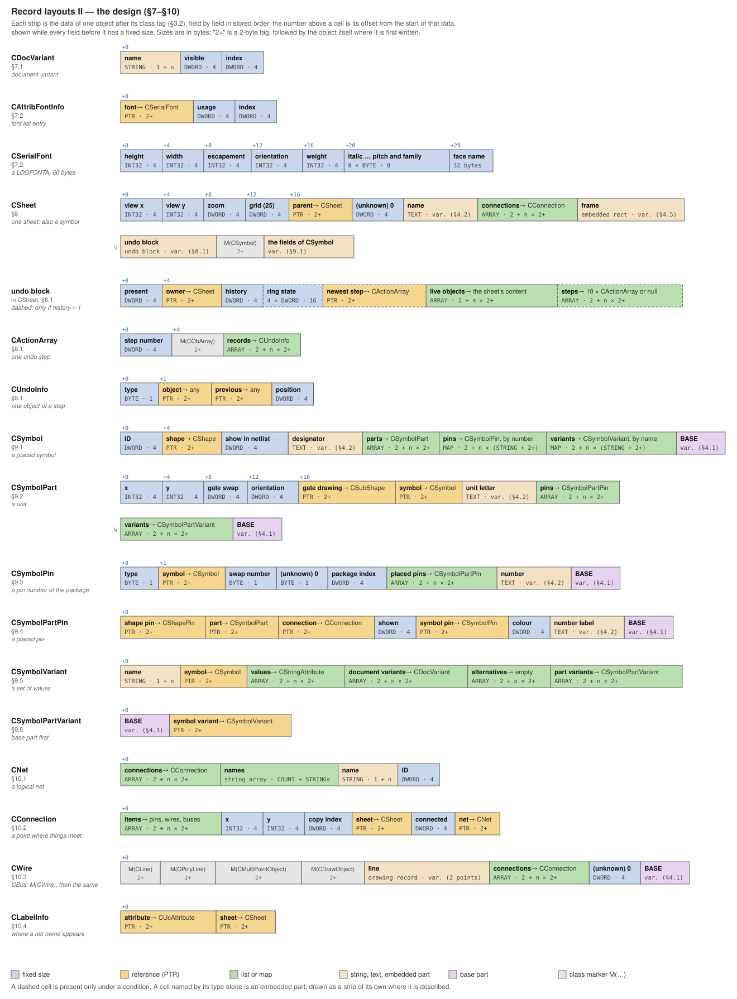

# Ulticap `.UTSCH` File Format

Reverse-engineered description of the binary schematic files of Ulticap V5 for Windows,
derived from the analysis of real `.UTSCH` files, the behaviour of the program and comparison
with its own ASCII export of the same designs. It describes every record found in the files —
also those a converter has no use for — and how a file is laid out when Ulticap writes one, so
that it can serve both a reader and a writer. The ASCII format (`.SCH`/`.BLK`) is described in
[FILEFORMAT_ULTICAP_SCH.md](FILEFORMAT_ULTICAP_SCH.md).

## Contents

[↑ README contents](../../README.md#file-formats)

- [About this document](#about-this-document)
- **Part I — The container and the shared building blocks**
  1. [Container](#1-container)
  2. [Stream header](#2-stream-header)
  3. [The object archive](#3-the-object-archive) (with a worked example)
  4. [Building blocks: base part, texts, attributes, drawing objects](#4-building-blocks)
  5. [Shapes](#5-shapes)
- **Part II — The design document**

  6. [Body order](#6-body-order)
  7. [Document variants and fonts](#7-document-variants-and-fonts)
  8. [Sheets](#8-sheets)
  9. [Placed symbols](#9-placed-symbols)
  10. [Nets and connections](#10-nets-and-connections)
  11. [Sheet graphics and free text](#11-sheet-graphics-and-free-text)
  12. [Writing a file](#12-writing-a-file)
- **Appendices**
  - [A. Classes](#appendix-a--classes)
  - [B. Code tables and attribute keys](#appendix-b--code-tables-and-attribute-keys)
  - [C. Unknowns and forms never seen](#appendix-c--unknowns-and-forms-never-seen)
  - [D. Values in designs read from ASCII](#appendix-d--values-in-designs-read-from-ascii)

---

## About this document

**Scope.** Every `.UTSCH` file examined — from 1999 up to files saved by Ulticap V5.72 — carries
the same document schema (`0x230`) and the same format version (`5.33`). That version is a
format version: it does not identify the program version that saved the file. Nothing else in a
file dates it.

**Structure.** Part I describes what is not specific to a schematic design: the container, the
archive encoding, the building blocks every object is made of, and the library shapes (symbol
definitions). Part II describes the design document built from them.

**Conventions.**

- All integers are little-endian. Coordinates are signed 32-bit integers in **Ulticap units**
  (1 unit = 2 mil = 0.0508 mm), with x to the right and **y up**, as in the ASCII format.
- Line widths (pen widths) are in Ulticap units too.
- Colours are Windows `COLORREF` values, `0x00BBGGRR`, in full RGB — not palette indexes.
- Class names (`CShape`, `CSymbolPart`, …) and attribute keys (`UT_VALUE`, …) are given exactly as
  they are stored in the files. The files store no field names: the field names used here are
  descriptions of what a field means.
- "Not seen" marks a form the encoding allows but that no file examined uses. Values whose
  meaning is unknown are listed with the values observed (Appendix C).

**Figures.** Five figures give an overview: the container (§1.3), a worked example of the stream's
first bytes (§3.7), the record layouts of Part I (§4) and of Part II (§6), and the object graph
(§6). The container figure and the worked example show
[`examples/blank.UTSCH`](../../examples/blank.UTSCH), a fresh save of a blank design.

**Notation** used in the layout tables:

| Notation⠀⠀⠀⠀ | Meaning |
|---|---|
| `BYTE`, `WORD`, `DWORD` | unsigned 8-, 16-, 32-bit integer |
| `INT32` | signed 32-bit integer |
| `STRING` | a string (§3.1) |
| `COUNT` | an element count (§3.1) |
| `POINTS` | a point list: `WORD` *n*, then *n* × (`INT32` x, `INT32` y) |
| `PTR` | an object reference: a new object written in full, a reference to an earlier one, or null (§3.2) |
| `ARRAY` | `COUNT` *n*, then *n* × `PTR` (§3.4) |
| `MAP` | `COUNT` *n*, then *n* × (`STRING` key, `PTR` value) (§3.4) |
| `M(CName)` | the class marker of class `CName` (§3.3) |
| `TEXT` | an embedded text object (§4.2) |
| `BASE` | the base part (§4.1) |

[↑ Contents](#contents)

---

# Part I — The container and the shared building blocks

## 1. Container

### 1.1 What a file is

A `.UTSCH` file is a Microsoft OLE **compound file** (structured storage; signature
`D0 CF 11 E0 A1 B1 1A E1`). It holds exactly one stream, named **`Contents`**, which carries the
whole design (§2 onward).

The root directory entry carries the class ID `{AAA59DC0-EF91-11CE-8513-444553540000}`, stored as
the bytes `c0 9d a5 aa 91 ef ce 11 85 13 44 45 53 54 00 00`. Every file has it, and a writer sets
it.

### 1.2 Reading

A reader follows the directory and the allocation table (FAT) as for any compound file:

- Sectors are 512 bytes in every file seen.
- A `Contents` stream shorter than 4,096 bytes is stored in the mini stream (64-byte mini
  sectors), a longer one in regular sectors.
- A file whose FAT needs more than the header's 109 entries continues the FAT list in extension
  (DIFAT) sectors; this happens from a stream size of about 6.9 MB.
- A file may contain **free sectors**, marked free in the FAT. This is ordinary compound-file
  behaviour: a sector that is no longer used is marked free but neither wiped nor removed. A fresh
  save (a new file) has two, sectors 0 and 1 (§1.3). A save over an existing file writes the new
  version into free space and frees the old one, so such a file also holds the previous version —
  its directory sector, its FAT and an older copy of the stream — in free sectors. A reader follows
  the directory and the FAT and never looks at free sectors.

The container carries no version information. The root entry's modification time is the time the
file was saved; its creation time is 0.

### 1.3 How Ulticap lays out a fresh save

A file Ulticap saves anew has a fixed layout, which a writer can reproduce exactly:

| Sector⠀⠀⠀⠀⠀⠀⠀⠀ | Content |
|---|---|
| (header) | signature; minor version `0x3E`, major version 3; byte order `0xFFFE`; sector shift 9 (512 bytes), mini sector shift 6 (64 bytes); the number of FAT sectors; directory start 2; mini stream cutoff 4,096; mini FAT start and count; DIFAT start and count; the first 109 FAT sector numbers |
| 0, 1 | free (contents: leftover memory) |
| 2 | the directory: `Root Entry` (a root storage, red; child = entry 1; the class ID of §1.1; creation time 0; modification time = save time), `Contents` (a stream, black, no siblings), two empty entries |
| 3 onward | the FAT sectors; a DIFAT sector, when needed, comes **right after the first FAT sector it lists** — after the 110th FAT sector, then after every further 127 |
| then | for a stream under 4,096 bytes: the mini FAT, then the mini stream (the root entry's stream); otherwise the `Contents` stream itself |

The last DIFAT sector's link to a next DIFAT sector is `0xFFFFFFFF` (free), not the end-of-chain
value. Between two fresh saves of the same design only the modification time and leftover memory
differ (the two free sectors and the unused tail of the stream's last sector). A file saved over
an earlier one can contain dead sectors and place its DIFAT sectors elsewhere; a reader must not
rely on the layout above.



*Figure 1 — The container of [`examples/blank.UTSCH`](../../examples/blank.UTSCH), a fresh save of a
blank design: the header and sectors 0–4 expanded above the sector row, the mini stream and the
`Contents` stream expanded below it.*

[↑ Contents](#contents)

## 2. Stream header

The `Contents` stream begins with:

| Offset | Type | Value | Meaning |
|---|---|---|---|
| 0 | `DWORD` | `0x00000230` | document schema number |
| 4 | `STRING` | `"5"` | format version, first part |
| 6 | `STRING` | `"33"` | format version, second part |

In bytes: `30 02 00 00 01 35 02 33 33`. The body follows at offset 9.

Every file examined has these values, from 1999 up to files saved by V5.72.

[↑ Contents](#contents)

## 3. The object archive

After the header, the stream is an **MFC object archive** (Microsoft Foundation Classes
`CArchive`): the design is written as a graph of objects, each introduced by a class tag, and an
object that has already been written is referred to by its number. Nothing in the stream gives the
length of an object, so a reader can only get past an object by reading it, and needs the layout
of every class it meets.

### 3.1 Values, strings and counts

- **Integers:** `BYTE`, `WORD`, `DWORD`, `INT32`, little-endian, unaligned.
- **`STRING`:** a length, then that many ANSI characters (Windows-1252: every font in the files
  has character set 0, `ANSI_CHARSET`), no terminator. The length is one byte
  (0–254); for 255–65,533 characters the byte `0xFF` followed by a `WORD`; for 65,534 or more
  `0xFF`, the `WORD` `0xFFFF` and a `DWORD`. Only the one-byte form has been seen; the longest
  string in the largest design examined has 38 characters. `0xFF` followed by the `WORD` `0xFFFE` would
  introduce a wide-character string; not seen.
- **`COUNT`:** a `WORD`; the value `0xFFFF` would be followed by a `DWORD` holding a larger count
  (not seen).
- **`POINTS`:** a `WORD` count, then the points as pairs of `INT32` in one block.

### 3.2 Object references and numbering

Wherever a layout has a `PTR`, the stream holds a 16-bit **tag**:

| Tag⠀⠀⠀⠀⠀⠀⠀⠀⠀⠀⠀ | Meaning |
|---|---|
| `0x0000` | null |
| `0xFFFF` | a **new class**: `WORD` schema number, `WORD` name length, the class name (ASCII), then the object's data |
| `0x8000 \| n` | a **new object of class n** (a class registered earlier), then the object's data |
| `0x0001`–`0x7FFE` | a **reference to object n**, written earlier; no data follows |
| `0x7FFF` | an extended number: a `DWORD` follows — an object number, or, with its top bit set, a class number (for a new object of that class) |

**Numbering.** Classes and objects share one counter, starting at 1. A class takes the next number
when it is first written; a new object takes the next number before its data is read. So `0xFFFF`
followed by a class and its object uses two numbers, `0x8000 | n` one, a reference none. A reader
that keeps this counter knows the number of every class and object in the stream; class numbers
differ from file to file.

**Extended numbers.** A design with more than 32,766 objects needs numbers from `0x7FFF` up, which
are written in the extended form: `0x7FFF`, then the `DWORD`. The largest designs examined (over
40,000 objects) use it, for references to objects and for new objects of a class whose number is
that high.

**First reference writes in full.** An object is written in full where it is first referred to,
and by number everywhere after. Because the graph is connected, the first reference to a large
object can pull in most of the design (in a schematic, the first net does — §6), and an object can
appear in the stream before the container that owns it.

A `WORD` with bit 15 set inside an object's data is a value, not a tag: the stream cannot be split
into objects without the layout of each class.

### 3.3 Class markers and class chains

Every class is part of a class chain (`CShapePin` → `CSchemaAttributePart` → `CSchemaPart` →
`CUndoableObject`). An object's own class is named by its tag. Its data is the fields of each class
of the chain in turn, from the object's own class down to the most basic, and every base class is
introduced by a **class marker**: a class tag with no object after it — `0xFFFF` with schema and
name the first time that class appears anywhere in the stream (taking a class number), `0x8000 | n`
afterwards. Written `M(CName)` in the layouts.

Example: a `CUcText` object is the tag of `CUcText`, the text's string, `M(CTextProperties)`, the
text properties, `M(CSchemaPart)`, `M(CUndoableObject)` (§4.2). `CUndoableObject` has no fields;
its marker closes most chains. Some classes have two bases in a row whose markers both appear
(the sheet graphics of §11).

### 3.4 Arrays and maps

- **`ARRAY`** — an MFC object array: `COUNT`, then that many `PTR`s. Most collections of the
  design are arrays; an array can also be stored as an object of its own class `CObArray`
  (schema 0), whose data is an `ARRAY`.
- **`MAP`** — an MFC string map: `COUNT`, then per entry a `STRING` key and a `PTR` value.
- **String array** — `COUNT`, then that many `STRING`s.

**The order of a map.** Ulticap writes a string map in hash order: 17 buckets, the hash of a key
being *h* = 33 · *h* + *c* over its characters (32-bit, starting at 0), bucket = *h* mod 17, the
buckets in ascending order, and within a bucket the newest key first. Observed from experiments:
every re-save writes the order within each bucket reversed. The order carries no meaning, and a
reader may ignore it. Keeping the stored order matters to a writer that edits a file in place, because
moving an entry can move the first full copy of an object (§3.2) and renumber everything after it.

### 3.5 Reading the whole stream

A stream is read completely when following the layouts of this document ends exactly on its last
byte; every file examined does. Every class that occurs must be known — there is no way to skip an
unknown object — so Appendix A lists every class found in the files.

### 3.6 Schema numbers

Each class is written with its schema number in its `0xFFFF` registration. Every file examined
carries exactly these:

| Schema⠀⠀ | Classes |
|---|---|
| `0x0212` | the application's classes not listed below |
| `0x0215` | `CNet` |
| `0x0217` | `CLabelInfo`, `CSymbolPart`, `CSymbolPartPin` |
| `0x0226` | `CSheet`, `CSymbolPin` |
| `0x0064` | the drawing base classes (`CDrawObject`, `CTwoPointObject`, `CMultiPointObject`, `CRectangle`, `CEllipse`, `CPolyLine`, `CPolygon`, `CLine`, `CArc`, `CPie`), `CUndoableObject`, `CSerialFont`, and the undo classes `CActionArray`, `CUndoInfo` |
| `0x0000` | `CObArray` |

A writer writes the numbers of the table.

### 3.7 Worked example

Figure 2 follows the first 369 bytes of the `Contents` stream of
[`examples/blank.UTSCH`](../../examples/blank.UTSCH) field by field: the stream header, the document
variant, the font, the start of the library map, and the first objects of the sheet shape. It shows
new classes and their numbers, nested objects written in full at their first reference, class
markers written in full the first time and as `0x8000 | n` after that, and leftover memory in a
font's face name.



*Figure 2 — The first 0x171 bytes of the `Contents` stream of `blank.UTSCH`.*

[↑ Contents](#contents)

---

## 4. Building blocks

Figure 3 shows the layouts of §4 and §5 as strips of fields, with their types, sizes and — as far
as they are fixed — offsets.



*Figure 3 — Record layouts of the building blocks and shapes.*

### 4.1 The base part

Pins, shapes, symbols, parts, wires and buses end with the same **base part**:

| Field | Type | Meaning |
|---|---|---|
| marker | `M(CSchemaAttributePart)` | |
| attributes | `ARRAY` | the object's attributes (§4.3) |
| marker | `M(CSchemaPart)` | |
| marker | `M(CUndoableObject)` | |

Written `BASE` in the layouts.

### 4.2 Text objects

A **text object** (`CUcText`) is a string with its presentation. It occurs as an object of its own
(a keyless text, §4.3) and **embedded** — without a tag of its own — in many other objects (a
symbol's designator, a pin's number, every attribute value). Written `TEXT` in the layouts, it is:

| Field | Type | Meaning |
|---|---|---|
| string | `STRING` | the text |
| marker | `M(CTextProperties)` | |
| frame | embedded rectangle (§4.5) | the text's extent on screen at the last redraw (below) |
| x, y | `INT32`, `INT32` | the text's anchor point (below) |
| key type | `WORD` | the key-type code of the attribute the text belongs to (§4.3) |
| anchor | `BYTE` | 0–8: the anchor's position on a 3 × 3 grid, rows counted from the top |
| visible | `BYTE` | 0 hidden, 1 shown, 2 shown with its key (below) |
| colour | `DWORD` | `COLORREF` |
| vertical | `DWORD` | 1 when the text is displayed vertically, 0 otherwise |
| font | `PTR` | a reference to a `CSerialFont` of the document's font list (§7) |
| markers | `M(CSchemaPart)`, `M(CUndoableObject)` | |

**Anchor point.** The coordinates are those of the text's owner: for the texts of a shape, its
gate drawings and its pins (§5), the symbol's own coordinates; for the texts of placed objects,
wires and sheets (Part II), absolute sheet coordinates. The anchor grid tells which point of the
text lies there:

```
0 top-left      1 top-centre      2 top-right
3 centre-left   4 centre          5 centre-right
6 bottom-left   7 bottom-centre   8 bottom-right
```

The anchor and the vertical flag describe the text **as displayed on the sheet**, after the
rotation and mirroring of the symbol it belongs to. No rotation angle is stored: a text is
horizontal or vertical. A vertical text also uses a font entry of its own whose escapement is a
quarter turn (§7).

**Size.** A text's size is its font's height (a Windows `LOGFONT` height, §7; a negative height
counts by its absolute value). The ASCII format's text size is two thirds of it, rounded down.

**Frame.** The frame is the area the text covered on screen when the design was last drawn. It
changes with the zoom and nothing else; it is not design data and a reader ignores it.

**Visible.** With 2, Ulticap shows the attribute as `KEY=value`. It has been seen only in designs
read from ASCII files, on attributes whose ASCII visibility had both bit 128 (shown) and bit 64
(tag shown) set.

**Markup in strings.** An overline is written `\^TEXT\^` — a backslash before each caret — where
the ASCII format writes `^TEXT^`. An attribute value may refer to another attribute of the same set
as `\@KEY\@`; Ulticap shows and exports the referenced value in its place.

### 4.3 Attributes

An attribute is a key and a value. It is stored in one of three forms:

| Class | Layout | Use |
|---|---|---|
| `CStringAttribute` | `STRING` value, `STRING` key, `WORD` key-type code, `M(CSchemaPart)`, `M(CUndoableObject)` | a plain value without presentation: the three device values of a symbol variant (§9) |
| `CUcAttribute` | `STRING` key, `M(CUcText)`, `TEXT` (its string is the value) | an attribute with presentation: almost every attribute |
| `CUcText` | `TEXT` | a **keyless** text in an attribute list: a graphic text of a symbol, or a free text on a sheet |

A `CUcAttribute` with an **empty key** is also a graphic text of a symbol (a gate's `>=1`, for
example). Both keyless forms are the ASCII format's `TXT`.

**Key-type codes.** The `WORD` of a `CStringAttribute` and the key-type field of every text object
classify the key:

| Code | Key |
|---|---|
| 2 | none (a keyless `CUcText`) |
| 3 | any other key |
| 4 | `UT_NETNAME` |
| 5 | `UT_DEVICE` |
| 6 | `UT_PKGTYPE` |
| 7 | `UT_VALUE` |
| 17 | `UT_SHEETNETNAME` |
| 18 | `UT_SHEETNAME` |

The texts of a pin's number labels, which have no key, carry 2 as well. Two exceptions occur after
copy and paste: part variants that no placed part uses — copy and paste leaves them behind —
carry 3 on their `UT_DEVICE`, `UT_PKGTYPE` and `UT_VALUE` (§9), and a keyless text pasted from
another file carries 3. A reader takes the key from the attribute, not from the code.

**Case.** Keys and net names are stored in upper case, and so are attribute values, except the
value of `UT_VALUE`, which keeps its case (`100nF`); a sheet name read from an ASCII file can keep
its case too. Derived from comparing `.SCH` and `.UTSCH` files of the same designs, and visible on
screen.

The keys found in the files, and where each occurs, are listed in Appendix B.

### 4.4 The drawing record

Every graphic — a symbol's lines, arcs and filled shapes, a wire, a bus, a line drawn on the sheet,
the frame of a text — ends in the same **drawing record**:

| Field | Type | Meaning |
|---|---|---|
| pen colour | `DWORD` | `COLORREF` |
| pen width | `DWORD` | in Ulticap units |
| pen style | `DWORD` | low byte: Windows pen style — 0 solid, 1 dash, 2 dot, 3 dash-dot; bit `0x10000` (`PS_GEOMETRIC`) is set on many pens and does not change the style |
| points | `POINTS` | the geometry, in the owner's coordinates |
| marker | `M(CUndoableObject)` | |

It is preceded by `M(CDrawObject)`, and before that by the markers and fields of the drawing
classes the object derives from (§4.5).

Every wire and bus has the pen (`0xFFFFFF`, 4, `0x10000`): wire and bus widths are not stored per
object.

### 4.5 Drawing objects

The graphics of a symbol (§5) are objects of these classes. Each is its class tag followed by:

| Class⠀⠀⠀⠀⠀ | Data after the tag | Points |
|---|---|---|
| `CUcPolyline` | `M(CPolyLine)`, `M(CMultiPointObject)`, `M(CDrawObject)`, record | 2 or more, an open line |
| `CUcLine` | `M(CLine)`, `M(CPolyLine)`, `M(CMultiPointObject)`, `M(CDrawObject)`, record | 2 |
| `CUcArc` | `M(CArc)`, `M(CDrawObject)`, record | 3: start, end, centre |
| `CUcPie` | `M(CPie)`, fill, `M(CArc)`, `M(CDrawObject)`, record | 3: start, end, centre |
| `CUcRect` | `M(CRectangle)`, fill, `M(CTwoPointObject)`, `M(CDrawObject)`, record | 4 corners |
| `CUcEllipse` | `M(CEllipse)`, fill, `M(CTwoPointObject)`, `M(CDrawObject)`, record | 4 corners of the bounding box |
| `CUcPolygon` | `M(CPolygon)`, fill, `M(CMultiPointObject)`, `M(CDrawObject)`, record | 3 or more corners |

"Record" is the drawing record of §4.4; **fill** is two `DWORD`s: filled (1) or not (0), and the
fill colour (`COLORREF`).

- **Arc:** a circle around the centre through the start point, drawn counter-clockwise from the
  start point to the end point; the radius is the distance from the centre to the start. A start
  point equal to the end point is a full circle.
- **Pie:** the arc, closed into a wedge by a straight line from each end point to the centre.
- **Rectangle and polygon:** the corners only; the outline is closed implicitly (the last corner
  connects to the first).
- **Ellipse:** the ellipse inscribed in the box given by the four corners. A box of zero width or
  height draws nothing.

**Embedded rectangle.** The frame of a text (§4.2) and the frame of a gate drawing (§5.2) are
rectangles written without a tag of their own: `M(CRectangle)`, fill, `M(CTwoPointObject)`,
`M(CDrawObject)`, record — the data of a `CUcRect` from its first marker on. In every file their
fill is (0, `0xFFFFFF`) and a gate drawing's frame has the pen (`0xFFFFFF`, 4, `0x10000`).

Ulticap for DOS had neither fills nor line widths beyond thin and thick. Reading such a design,
Ulticap V5 stores a thick solid symbol line as a filled four-point polygon around the line, with a
pen of width 1 and the line's colour as the fill colour (Appendix D).

[↑ Contents](#contents)

---

## 5. Shapes

A **shape** is a symbol definition: its drawing, its pins, and the template for the texts of every
placement. A design holds one library of shapes, shared by all its sheets (§6); every placed symbol
refers to one.

```
CShape                 the symbol definition: name, designator template, attributes
 └─ CSubShape          a gate drawing: graphics, frame, pins (one per gate type)
     └─ CShapePin      a pin: position, orientation, type, one number per gate
```

A shape's own coordinates have their origin at the bottom-left corner of its frame (§5.2).

### 5.1 `CShape`

| Field | Type | Meaning |
|---|---|---|
| gate drawings | `ARRAY` | its `CSubShape`s, in gate order: one for an ordinary symbol, one per gate type for a part with dissimilar gates (§5.4) |
| designator template | `TEXT` | the designator's template value: a prefix and `?` (`U?`, `R?`); a bare `?` for no prefix |
| name | `STRING` | the library name |
| show in netlist | `DWORD` | 1 for components; 0 for power and ground symbols, ports, title blocks and sheet shapes |
| | `BASE` | the shape's `UT_DEVICE`, `UT_PKGTYPE` and `UT_VALUE`; its other template attributes are on the gate drawing (§5.2) |

The designator template takes its value from this text and its position and presentation from the
gate drawing's `$` text (§5.2).

### 5.2 `CSubShape` (gate drawing)

| Field | Type | Meaning |
|---|---|---|
| graphics | `ARRAY` | the drawing objects of §4.5 |
| frame | embedded rectangle | the symbol's extent: corners (0, 0) and (width, height) |
| pins | `ARRAY` | its `CShapePin`s |
| designator text | `TEXT` | the string `$`: where and how the designator is shown |
| gate count | `DWORD` | the number of gates (the ASCII format's `PARTS`); 1 for a shape without pins |
| name | `STRING` | usually the shape's name; `<device>/<n>` for a gate type (§5.4); not reliable otherwise — it can keep an earlier name |
| external gate swap | `DWORD` | 1: the gates may be swapped with gates of another package during back-annotation; 0: not |
| | `BASE` | the template attributes, with their presentation |

The frame's centre is where a symbol's attributes take effect: every attribute that does not belong
to a pin has its point of effect there. Observed from experiments: the external-gate-swap flag is
1 on every symbol drawn in the symbol editor or placed from Ulticap's libraries; 0 occurs on sheet
shapes and on some symbols from other sources, among them some read from ASCII files.

### 5.3 `CShapePin`

| Field | Type | Meaning |
|---|---|---|
| x, y | `INT32`, `INT32` | where the pin meets the symbol body, in the symbol's coordinates |
| internal connect number | `BYTE` | pins with the same non-zero number are connected inside the part (0 in every file seen) |
| colour | `DWORD` | `COLORREF` |
| style | `BYTE` | flags, below |
| orientation | `DWORD` | 0–3, below |
| type | `BYTE` | 0–8, the pin type, below |
| swap number | `BYTE` | pins of one gate with the same non-zero number may be swapped during back-annotation |
| number labels | `ARRAY` | `CUcText`s: the pin's number, one per gate (§5.4) |
| | `BASE` | the pin's attributes |

**Orientation** — where the pin points, from the body outward; its outer end, where a wire connects,
lies on the frame's edge in that direction:

| Value | Pin points | Outer end |
|---|---|---|
| 0 | right | (frame width, y) |
| 1 | up | (x, frame height) |
| 2 | left | (0, y) |
| 3 | down | (x, 0) |

**Type** — the entries of the pin type list in Ulticap's symbol editor, in list order:

| Value | Type | ASCII `PINTYPE` |
|---|---|---|
| 0 | In | `IN` |
| 1 | Out | `OUT` |
| 2 | Open collector | `OC` |
| 3 | Open emitter | `OE` |
| 4 | Bi-directional | `BI` |
| 5 | Tri-state | `TRI` |
| 6 | Passive | `PAS` |
| 7 | Power | `PWR` |
| 8 | Not connected | `NC` |

**Style flags** — the six pin styles of the symbol editor; any combination can be given to a pin
of any type:

| Bit | Style | Meaning |
|---|---|---|
| 1 | IEC | IEC form: an input or output qualifier, by the pin's type |
| 2 | Clock | clock |
| 4 | Inverted | bubble |
| 8 | Invisible | hidden: the pin is not drawn and connects by name (below) |
| 16 | Bus | bus pin |
| 32 | Common | one pin number shared by every gate |

**Attributes** of a shape pin: `UT_PINNAME` (the pin's name, shared by every placement),
`UT_NETNAME` (the net the pin connects to by name: a power pin, a hidden pin, a port),
`UT_SHEETNETNAME` (on the pins of a subsheet box), `PORT`, and simulator data (`SPICE#`,
`SPICEAGEPIN`). A **hidden pin** connects to the net named by its `UT_NETNAME`; one without it
connects nothing, and Ulticap's ASCII export leaves it out. A placed symbol can override these
values per placement (§9).

### 5.4 Gates, gate types and pin numbers

- **Several gates.** A gate drawing serves every gate of its package: the gate count says how many,
  and each pin carries **one number label per gate** — label *g* is the pin's number in gate *g*
  (gate A first). Joined by commas, the labels give the ASCII format's combined pin-number string.
  The gate count equals the largest number of labels on one pin.
- **Common pins.** A supply pin shared by every gate stores the same number once per gate; the
  style flag 32 marks pins that are one pin for all gates.
- **Dissimilar gates.** A part whose gates differ is one shape with one gate drawing per **gate
  type**, in gate order, each with its own graphics, pins and gate count. Each placed gate refers
  to the gate drawing of its type. Ulticap names such gate drawings `<device>/<n>`, the ASCII
  format's convention for gate types. Ulticap V5.72's own symbol browser, gate swap and symbol
  editor reach only the first gate drawing.
- **Visibility of a number.** A pin shows its number when its number label is visible.

[↑ Contents](#contents)

---

# Part II — The design document

## 6. Body order

After the header (§2), the body of a schematic is, in this order:

| Item⠀⠀⠀⠀⠀⠀⠀⠀⠀⠀⠀⠀⠀⠀⠀⠀ | Layout | Section |
|---|---|---|
| document variants | `WORD` *n*, then *n* `CDocVariant` objects | §7.1 |
| font list | `WORD` *n*, then *n* font entries | §7.2 |
| nets | `COUNT` *n*, then *n* × `PTR` to a `CNet` | §10 |
| library map | `MAP`: library name → `CShape` | §5 |
| designator map | `MAP`: reference designator → `CSymbol` | §9 |
| sheets | `ARRAY` of `CSheet`, every sheet of the design | §8 |
| label index | `DWORD` *n*, then *n* × `PTR` to a `CObArray` holding one `CLabelInfo` | §10.4 |
| net-name map | `MAP`: net name → `CObArray` of `CLabelInfo` | §10.4 |
| OLE items | `COUNT` *n*, then *n* × `PTR` (0 in every file) | — |
| end | `WORD` 0 | — |

A design with no nets stores a net count of 0. The **first net is written in full and pulls in
almost the whole design** through its connections (§3.2): its pins, their parts, symbols, shapes
and sheets. The other nets are then mostly references, and each container after the nets refers to
objects that are, by then, nearly all written. A reader therefore has to follow the references; it
cannot read the containers one after the other as independent lists.

The **label index** is a second index of the net-label records of the net-name map — the same
objects. Only its values are stored; it has no keys in the file.

The library map holds every shape of the design: **one shape library, shared by all sheets**.

Figure 4 shows the classes of a design and the references between them; Figure 5 the layouts of
the classes of Part II.



*Figure 4 — The object graph of a design.*



*Figure 5 — Record layouts of the design classes (§7–§10).*

[↑ Contents](#contents)

## 7. Document variants and fonts

### 7.1 Document variants

Each `CDocVariant` object is:

| Field | Type | Meaning |
|---|---|---|
| name | `STRING` | `DEFAULT` for the first; further variants as the user names them |
| visible | `DWORD` | 1 on the one variant Ulticap shows, 0 on the others |
| index | `DWORD` | 0, 1, 2 … |

A design without schematic variants has one, (`DEFAULT`, 1, 0). Making another variant visible
changes only these two `DWORD`s. Symbol variants refer to these objects (§9.5). A document variant
can also appear later in the stream as an ordinary object with the same layout.

### 7.2 Fonts

A font entry is a `CAttribFontInfo` object whose data is:

| Field | Type | Meaning |
|---|---|---|
| font | a `CSerialFont` object (its own tag), 60 bytes | a Windows `LOGFONTA` |
| usage | `DWORD` | a usage count (below) |
| index | `DWORD` | the entry's index, 0, 1, 2 … |

The `LOGFONTA` is: height, width, escapement, orientation, weight (five `INT32`); italic,
underline, strike-out, character set, output precision, clip precision, quality, pitch and family
(eight `BYTE`s); the face name (32 bytes, NUL-terminated). The bytes after the face name's NUL hold
leftover memory and differ between saves; a reader ignores them.

- Every text refers to the `CSerialFont` of one entry (§4.2). **Entry 0 is the document's default
  font** — Arial, height 56 (8 pt), regular, in the designs made or read in V5.72; Arial Narrow 40 in
  some older designs.
- A text's **size** is its font's height (§4.2). A **vertical** text uses an entry of its own whose
  escapement and orientation are a quarter turn: −900 (designs read from ASCII) or 2700 (texts
  made vertical in V5.72). No other escapement occurs.
- The **usage count** is at least the number of texts that use the font, often more (Ulticap's
  temporary objects count too). A writer may keep the stored count; it need only not fall below the
  number of users.

[↑ Contents](#contents)

## 8. Sheets

A `CSheet` is one sheet of the design. A sheet is also a symbol: after its own fields comes the
marker of `CSymbol` and a complete symbol (§9.1), which is the sheet's frame.

| Field | Type | Meaning |
|---|---|---|
| view x, view y | `INT32`, `INT32` | the top-left corner of the visible window, in stored coordinates; zooming and scrolling change it |
| zoom | `DWORD` | the zoom factor in percent (100 in a new design) |
| grid | `DWORD` | the sheet's grid: 25 in every file (below) |
| parent | `PTR` | the parent sheet; null on the root sheet |
| (unknown) | `DWORD` | 0 in every file |
| name | `TEXT` | the sheet's name |
| connections | `ARRAY` | the sheet's `CConnection`s, including those under no net (§10) |
| frame | embedded rectangle | the page: an A4 sheet is 5,246 × 3,534 units, centred on (0, 0) |
| undo block | below | the live object list and the saved undo history |
| marker | `M(CSymbol)` | |
| symbol | the fields of §9.1 | the sheet's frame symbol |

**Coordinates.** Stored coordinates are centred on the sheet. Ulticap shows them shifted so that
the page's bottom-left corner is (0, 0): on-screen = stored − the frame's bottom-left corner.

**The grid.** Two grids are involved. The **visual grid** — the spacing of the grid dots, 25 or 50
units — is a program setting kept in the Windows registry, not in the file: two designs differing
only in this setting have identical streams. The **snap grid**, the step in which the cursor
places objects, is 25 units in V5.72 and cannot be changed. The sheet's grid field is 25 in every
file, also for designs read from ASCII files drawn on another grid. Observed from experiments: a
file whose grid field holds 50 or 100 opens with a snap grid of 25, and Ulticap writes 25 again
when it saves it. The field is a per-sheet grid that V5.72 neither shows nor applies;
a writer writes 25.

### 8.1 The undo block: the live object list and the undo history

| Field | Type | Meaning |
|---|---|---|
| present | `DWORD` | 1 in every file; if 0, nothing of the block follows |
| owner | `PTR` | the sheet itself |
| history | `DWORD` | 1 when Ulticap's undo option was on (the ring follows, possibly empty), 0 otherwise |
| ring state | 4 × `DWORD` | only if history = 1: newest slot, current slot, a flag (1 when steps are saved), newest step number |
| newest step | `PTR` | only if history = 1: the newest slot's step, or null when no step is saved |
| live objects | `ARRAY` | **the sheet's content**: its placed parts, wires, buses, free texts and sheet graphics |
| steps | `ARRAY` | only if history = 1: the ring of 10 slots, each a `CActionArray` or null |

The **live object list is the design**; everything placed on the sheet is in it, and nothing else
is. A reader ignores the history.

**The undo history** is saved only when Ulticap's undo option is on, and it is not restored when a
file is opened again. It is a ring of 10 slots; a step's number runs 0–10 and wraps, the oldest step
is in the slot after the newest, and after an Undo the current slot is one behind the newest. A
step (`CActionArray`) is a `DWORD` (its step number), `M(CObArray)` and an `ARRAY` of `CUndoInfo`
records, one per object the action touched:

| Field | Type | Meaning |
|---|---|---|
| type | `BYTE` | 1 added, 2 removed, 3 changed |
| object | `PTR` | the object (a removed object is kept whole here) |
| previous | `PTR` | for type 3, a copy of the object's previous state |
| position | `DWORD` | the object's position in the live object list |

### 8.2 Hierarchy

A hierarchical design is one file holding every sheet; the sheet array lists them all. Each sheet
points to its **parent**; the root's parent is null.

A sheet's frame symbol has exactly one part, its **frame part**. For every sheet except the root,
that frame part is also in the parent sheet's live object list: **the subsheet box the parent shows
is the child sheet's own frame part.** So a box's symbol is the child sheet itself, and the
connection between parent and child is a stored pointer, both ways. A box carries the attribute
`UT_SHEETNAME`, the child's name as Ulticap draws it at the box's stored position; its pins carry
`UT_SHEETNETNAME`, the names that connect to the child sheet's ports. A root sheet's frame part is
in no live list and may have no `UT_SHEETNAME`; the sheet's name is its own name text.

The frame symbol's shape is `UT_SHEETSHAPE` for a sheet without pins, or the box shape that gives
the subsheet box its pins. Its designator is normally empty; its show-in-netlist flag is 0.

[↑ Contents](#contents)

## 9. Placed symbols

A placed component is a **symbol** (`CSymbol`) with one **part** (`CSymbolPart`) per unit (gate),
and one **pin** (`CSymbolPin`) per pin number of its package. Each part has its **placed pins**
(`CSymbolPartPin`). The values — device, package, value — are on **symbol variants** and **part
variants**.

```
CSymbol                designator, shape, ID
 ├─ CSymbolPart        one per unit: position, orientation, unit letter, gate drawing
 │   ├─ CSymbolPartPin one per pin of the unit: connection, number label, overrides
 │   └─ (part variants: the unit's attributes, one per symbol variant)
 ├─ CSymbolPin         one per pin number of the package
 └─ CSymbolVariant     one per set of values: device, package, value
```

### 9.1 `CSymbol`

| Field | Type | Meaning |
|---|---|---|
| ID | `DWORD` | the symbol ID (below) |
| shape | `PTR` | the shape (§5) the symbol is placed from |
| show in netlist | `DWORD` | equal to the shape's flag: 1 for components, 0 for power symbols, ports, title blocks and sheets |
| designator | `TEXT` | the reference designator, without unit letter |
| parts | `ARRAY` | one `CSymbolPart` per unit of the package, placed or not, in gate order |
| pins | `MAP` | pin number → `CSymbolPin` |
| variants | `MAP` | name (`SYMVAR1`, …) → `CSymbolVariant` |
| | `BASE` | (no attributes in any file) |

**Symbol IDs.** Observed from experiments: sheets and symbols draw their IDs from one counter. A new symbol asks for 0, a
pasted one for the ID it had; it keeps the ID it asks for if that is free, and otherwise gets the
next number after the last one given out. Loading, saving or creating a design, and removing or
renaming a symbol, restart the count (the next number is then the lowest free one). A root sheet has
ID 0 in a design made in V5.72 and 1 in one read from ASCII (Appendix D).

**The designator** is stored twice: as this text, and as the symbol's key in the designator map
(§6). Nothing else in the file repeats it. A multi-unit part stores it once, without unit letter; the
parts hold the letters. The text's own presentation fields are unused (position (0, 0) unless the
designator was edited in Ulticap's dialog); the placed designator is drawn from each part's text.
A symbol without a real designator — a power symbol, a port, a title block — has a placeholder
(`!18!`, or a bare number), and a gate Ulticap could not fit into an existing package when reading an
ASCII design gets one too (Appendix D).

### 9.2 `CSymbolPart` (a unit)

| Field | Type | Meaning |
|---|---|---|
| x, y | `INT32`, `INT32` | the placement point (usually (0, 0) for an unplaced unit) |
| gate swap | `DWORD` | a copy of the gate drawing's external-gate-swap flag (§5.2); 0 on frame parts |
| orientation | `DWORD` | 0–7 (below) |
| gate drawing | `PTR` | the `CSubShape` of the unit's gate type |
| symbol | `PTR` | its `CSymbol`; **null for a unit that is not placed** |
| unit letter | `TEXT` | `A`, `B`, …; also the presentation of the placed designator |
| pins | `ARRAY` | its `CSymbolPartPin`s |
| variants | `ARRAY` | its `CSymbolPartVariant`s, one per symbol variant (§9.5) |
| | `BASE` | `UT_SHEETNAME` on a subsheet box (§8.2); nothing on a component |

**Placement.** A point (x, y) of the shape (§5) lies on the sheet at the part's (x, y) plus the
point turned by the orientation code — the ASCII format's rotation code:

| Code | 0 | 1 | 2 | 3 | 4 | 5 | 6 | 7 |
|---|---|---|---|---|---|---|---|---|
| turn (counter-clockwise) | 0° | 90° | 180° | 270° | 0° | 90° | 180° | 270° |
| mirrored | no | no | no | no | yes | yes | yes | yes |

Turning (x, y) by 90° gives (−y, x); a mirrored code turns first and then negates x. A pin's outer
end (§5.3) placed this way is the point of its connection (§10).

- A unit is **placed** when it has a symbol pointer and is in a sheet's live object list. An
  unplaced unit of a multi-unit package has a null symbol pointer and is in no list.
- The **displayed designator** of a unit is the symbol's designator followed by the unit letter —
  only when the package has more than one unit. A single-unit part stores the letter `A` as well,
  hidden.
- The shape is the **symbol's** shape pointer. The gate drawing a part refers to is the one of its
  gate type; its name field can be out of date.

### 9.3 `CSymbolPin` (a pin number of the package)

| Field | Type | Meaning |
|---|---|---|
| type | `BYTE` | a copy of the shape pin's type (§5.3) |
| symbol | `PTR` | its `CSymbol` |
| swap number | `BYTE` | a copy of the shape pin's swap number |
| (unknown) | `BYTE` | 0 in every file |
| package index | `DWORD` | the pin's position in the package (below) |
| placed pins | `ARRAY` | the `CSymbolPartPin`s carrying this number |
| number | `TEXT` | the pin number |
| | `BASE` | (no attributes) |

**Package index.** List the package's pins gate by gate — the gate drawings in order, each of their
gates in turn, the shape pins in stored order — and number each pin number the first time it
occurs: a 7400 gives pins 1, 2, 3 → 0, 1, 2; supply pins 7, 14 → 3, 4; pins 4, 5, 6 → 5, 6, 7; and
so on. Designs read from ASCII may carry other values, repeats included. No reader needs the value.

### 9.4 `CSymbolPartPin` (a placed pin)

| Field | Type | Meaning |
|---|---|---|
| shape pin | `PTR` | the `CShapePin` it is placed from |
| part | `PTR` | its `CSymbolPart` |
| connection | `PTR` | its `CConnection` (§10) |
| shown | `DWORD` | 0 when the shape pin is hidden (connected by name), 1 otherwise |
| symbol pin | `PTR` | its `CSymbolPin` |
| colour | `DWORD` | `COLORREF` |
| number label | `TEXT` | the pin number shown for this unit (the gate's number), with its own presentation |
| | `BASE` | per-placement values (below) |

The attributes of a placed pin override the shape pin's for this placement: `UT_PINNAME` (the
pin's name), `UT_NETNAME` (the net it connects to by name — a power or ground pin, a port, a named
stub whose shape default is `?`), `UT_SHEETNETNAME` (a subsheet box's pin), `PORT`, simulator data
(`SPICE#`, `SPICEAGEPIN`), and plain texts keyed `LABEL1`, `LABEL2`, … which connect nothing.

### 9.5 Symbol variants, part variants and schematic variants

| `CSymbolVariant` field | Type | Meaning |
|---|---|---|
| name | `STRING` | `SYMVAR1`, `SYMVAR2`, … |
| symbol | `PTR` | its `CSymbol` |
| values | `ARRAY` | three `CStringAttribute`s: `UT_DEVICE`, `UT_PKGTYPE`, `UT_VALUE` |
| document variants | `ARRAY` | references to the `CDocVariant`s (§7.1) this set of values belongs to |
| alternatives | `ARRAY` | empty in every file |
| part variants | `ARRAY` | the `CSymbolPartVariant`s of this set of values |

A **part variant** (`CSymbolPartVariant`) is the **base part first** — the unit's attributes in
this variant: `UT_DEVICE`, `UT_PKGTYPE`, `UT_VALUE` with their presentation, user attributes,
graphic texts, title-block entries — then a `PTR` to its `CSymbolVariant`.

- A symbol has one symbol variant per set of values; a design without schematic variants has one
  per symbol, belonging to `DEFAULT`, and its values repeat those of its part variants.
- A placed part has **one part variant per symbol variant** (its variants array). A part **shows**
  the values of the part variant whose symbol variant belongs to the **visible** document variant.
- A part is **left out** of a document variant when none of its symbol variants lists that variant;
  Ulticap then does not show it while that variant is visible. Deleting a part removes it from every
  variant.
- Copy and paste can leave part variants behind that no placed part uses; their device, package and
  value texts carry key-type code 3 (§4.3). A reader goes by the part's variants array, never by
  position in a list.

### 9.6 Points of effect and attribute positions

The texts of a placed symbol are stored at their **absolute** sheet position, already turned with
the part. Their **point of effect** — the point a text belongs to, which the ASCII format stores
beside each text — is not stored; it follows from the owner: a pin's texts (its number, its name,
its net name, its other attributes) take the pin's connection point; every other attribute takes
the centre of the gate drawing's frame (§5.2), placed with the part.

### 9.7 Which names are net names

A name connects a net only as:

- a **wire's or bus's `UT_NETNAME`** (§10.3);
- the **`UT_NETNAME` of a symbol's own pin** — a power or ground symbol, a port, a named stub, a
  hidden pin — or the `UT_SHEETNETNAME` of a subsheet box's pin.

Every other name a symbol carries is plain text: `LABEL1` … on pins, a `UT_NETNAME` on the symbol
as a whole, a moved pin-name text, and any attribute keyed `LABEL`. Ulticap's own netlists bear
this out.

[↑ Contents](#contents)

## 10. Nets and connections

```
CNet                  name, ID
 └─ CConnection       a point on a sheet where things meet
     └─ items         placed pins (CSymbolPartPin), wires and buses (CWire, CBus)
```

### 10.1 `CNet`

| Field | Type | Meaning |
|---|---|---|
| connections | `ARRAY` | its `CConnection`s |
| names | string array | the name(s) given to the net (usually one, equal to the name); empty for an automatically named net |
| name | `STRING` | the net's name; `$$nnnn` for an automatically named net |
| ID | `DWORD` | a net ID, unique within the file |

- **Each net is written in full exactly once.** A net is the **logical net** of the design: its
  connections can lie on several sheets of a hierarchical design.
- An automatic name `$$nnnn` takes the lowest free number. Editing a net replaces it by a new net
  object with a new ID. Net names are stored in upper case (§4.3).
- **A netlist follows from the nets:** a net's members are the placed pins among the items of its
  connections — the part's designator (with unit letter only for multi-unit packages; §9.2) and the
  placed pin's number.

### 10.2 `CConnection`

| Field | Type | Meaning |
|---|---|---|
| items | `ARRAY` | the placed pins, wires and buses that meet here |
| x, y | `INT32`, `INT32` | the point, in sheet coordinates (a pin's outer end, a wire's end) |
| copy index | `DWORD` | observed from experiments: the connection's number in the last Copy or Cut that included it (0, 1, 2 … per copied block); no meaning in a saved design |
| sheet | `PTR` | its `CSheet` |
| connected | `DWORD` | 0 when its only item is a hidden pin (connected by name), 1 otherwise |
| net | `PTR` | its `CNet`; null on a connection that belongs to no net (seen on buses) |

The sheet's connection list (§8) holds its connections, including those under no net.

### 10.3 Wires and buses

| `CWire` field | Type | Meaning |
|---|---|---|
| line | `M(CLine)`, `M(CPolyLine)`, `M(CMultiPointObject)`, `M(CDrawObject)`, drawing record (§4.4) | the segment: two points, its ends |
| connections | `ARRAY` | the `CConnection`s at its ends |
| (unknown) | `DWORD` | 0 in every file |
| | `BASE` | its attributes (below) |

A **bus** (`CBus`) is `M(CWire)` followed by the same fields. Every wire and bus has the same pen
(`0xFFFFFF`, 4, `0x10000`): widths are not stored per object.

- A wire drawn point to point is stored as one two-point object per segment, shared points
  repeated.
- A wire's or bus's **`UT_NETNAME`** is its net label. Its point of effect — where it attaches —
  is the wire's **first** stored point.
- Any other attribute on a wire is plain text: an attribute the user keys `LABEL` included (§9.7).
  Designs read from ASCII can keep other annotations there (`WIDTH=30`).

**Junction dots are not stored.** A `.UTSCH` has no junction records; a junction follows from the
connections of §10.2. Ulticap draws a dot at a connection in three cases:

- a wire meets a bus there;
- a wire or bus passes through the point, without ending there;
- three or more wires, buses or pins end there.

Two things that simply end at the same point make no dot: that is a corner or a plain join.

**Crossing wires.** Where two wires cross and neither ends at the crossing:

- if no connection is stored at the crossing point, the wires are not connected there and no dot is
  drawn — even when both belong to the same net through other connections or through a net name;
- if a connection at the crossing point lists both wires, they are connected there and a dot is
  drawn. Ulticap stores this when a wire is drawn up to the other wire and continued from there;
  the continued wire stays one segment.

### 10.4 Net labels: `CLabelInfo` and the two indexes

A `CLabelInfo` is two `PTR`s: the attribute that names a net (a wire's or pin's `UT_NETNAME`, or a
subsheet box pin's `UT_SHEETNETNAME`) and the `CSheet` it is on. The **net-name map** (§6) gives,
per net name, a `CObArray` of these records — every place that name appears. The **label index**
holds the same records again, one per entry. Both can be rebuilt from the attributes.

[↑ Contents](#contents)

## 11. Sheet graphics and free text

The live object list of a sheet (§8.1) holds, besides parts, wires and buses:

| Class | Data after the tag |
|---|---|
| `CSheetLine` | as a `CUcLine` (§4.5), then `M(CSchemaPart)`, `M(CUndoableObject)` |
| `CSheetArc` | `M(CArc)`, `M(CDrawObject)`, record, then `M(CSchemaPart)`, `M(CUndoableObject)` |
| `CSheetRect` | as a `CUcRect`, then `M(CSchemaPart)`, `M(CUndoableObject)` |
| `CUcAttribute` | a free text keyed `TEXT`, or `TEXT-n-m…` (numbered keys appear after copying) |
| `CUcText` | a free text without key |

Sheet graphics have no attribute list. A free text is horizontal or vertical (§4.2), at its anchor
point and anchor grid position, with its font, colour and visibility. A free text pasted from
another file carries key-type code 3.

[↑ Contents](#contents)

## 12. Writing a file

**Editing in place.** The archive stores no offsets and no object lengths, only each string's own
length. A string can therefore be replaced by one of another length without touching anything
else, as long as no object is added or removed and no first full copy of an object moves (§3.2).
This is how a **designator** is renamed: its two strings (§9.1) are replaced. Ulticap's own rename
changes the same two strings and otherwise only data nothing reads back — font usage counts, text
frames, the symbol's own unused text record — and records no undo step. Keep the order of the maps
(§3.4).

**Writing a whole stream** means writing every object of the graph with the numbering of §3.2, each
in full where it is first referred to, every class with the schema of §3.6, and the body in the
order of §6. Fields a writer can leave as found or set to fixed values:

- text frames (§4.2) and the bytes after a font's face name (§7.2): display data and leftover memory;
- font usage counts: at least the number of texts using the font;
- the undo history (§8.1): present flag 1, history 0, and nothing more;
- connection copy indexes (§10.2): any value, 0 for new connections;
- the map order (§3.4): any order is read.

**The container** of a fresh save is laid out as §1.3 describes; a writer that follows it produces
files identical to Ulticap's, apart from the save time and leftover memory.

**Re-saves by Ulticap.** Generating a netlist in Ulticap silently saves the file again (the
previous file is kept as `.ucBak`): the same objects, an empty undo history dropped, the net-name
map in another order, other leftover bytes.

[↑ Contents](#contents)

---

## Appendix A — Classes

Every class found in the files, its schema number, its class chain (the markers that follow its own
fields, §3.3) and where it is described.

| Class⠀⠀⠀⠀⠀⠀⠀⠀⠀⠀⠀ | Schema | Chain after its own fields | Section |
|---|---|---|---|
| `CDocVariant` | `0x0212` | — | §7 |
| `CAttribFontInfo` | `0x0212` | — | §7 |
| `CSerialFont` | `0x0064` | — | §7 |
| `CNet` | `0x0215` | — | §10 |
| `CConnection` | `0x0212` | — | §10 |
| `CLabelInfo` | `0x0217` | — | §10 |
| `CSheet` | `0x0226` | `CSymbol`, then as `CSymbol` | §8 |
| `CSymbol` | `0x0212` | base part | §9 |
| `CSymbolPart` | `0x0217` | base part | §9 |
| `CSymbolPin` | `0x0226` | base part | §9 |
| `CSymbolPartPin` | `0x0217` | base part | §9 |
| `CSymbolVariant` | `0x0212` | — | §9 |
| `CSymbolPartVariant` | `0x0212` | base part (written first) | §9 |
| `CShape` | `0x0212` | base part | §5.1 |
| `CSubShape` | `0x0212` | base part | §5.2 |
| `CShapePin` | `0x0212` | base part | §5.3 |
| `CWire` | `0x0212` | base part | §10 |
| `CBus` | `0x0212` | `CWire`, then as `CWire` | §10 |
| `CUcText` | `0x0212` | `CTextProperties`, `CSchemaPart`, `CUndoableObject` | §4.2 |
| `CUcAttribute` | `0x0212` | `CUcText`, then as `CUcText` | §4.3 |
| `CStringAttribute` | `0x0212` | `CSchemaPart`, `CUndoableObject` | §4.3 |
| `CUcPolyline`, `CUcLine`, `CUcArc`, `CUcPie`, `CUcRect`, `CUcEllipse`, `CUcPolygon` | `0x0212` | drawing classes (§4.5) | §4.5 |
| `CSheetLine`, `CSheetArc`, `CSheetRect` | `0x0212` | drawing classes, then `CSchemaPart`, `CUndoableObject` | §11 |
| `CActionArray` | `0x0064` | `CObArray` | §8 |
| `CUndoInfo` | `0x0064` | — | §8 |
| `CObArray` | `0x0000` | — | §3.4 |
| `CSchemaAttributePart`, `CSchemaPart`, `CTextProperties` | `0x0212` | (markers only) | §4 |
| `CDrawObject`, `CTwoPointObject`, `CMultiPointObject`, `CRectangle`, `CEllipse`, `CPolyLine`, `CPolygon`, `CLine`, `CArc`, `CPie`, `CUndoableObject` | `0x0064` | (markers only) | §4.4, §4.5 |

Forms the encoding allows but no file examined uses are listed in Appendix C.

[↑ Contents](#contents)

## Appendix B — Code tables and attribute keys

### B.1 Codes

| Field⠀⠀⠀⠀⠀⠀⠀⠀⠀⠀⠀⠀⠀ | Values | Section |
|---|---|---|
| orientation of a part | 0–7: quarter turns counter-clockwise (0–3), mirrored (4–7) | §9.2 |
| orientation of a pin | 0 right, 1 up, 2 left, 3 down | §5.3 |
| pin type | 0 in, 1 out, 2 open collector, 3 open emitter, 4 bidirectional, 5 tri-state, 6 passive, 7 power, 8 not connected | §5.3 |
| pin style (flags) | 1 IEC, 2 clock, 4 inverted, 8 invisible, 16 bus, 32 common | §5.3 |
| text anchor | 0–8, a 3 × 3 grid, rows from the top: 0 top-left … 8 bottom-right | §4.2 |
| text visibility | 0 hidden, 1 shown, 2 shown with its key | §4.2 |
| key type | 2 none, 3 other, 4 `UT_NETNAME`, 5 `UT_DEVICE`, 6 `UT_PKGTYPE`, 7 `UT_VALUE`, 17 `UT_SHEETNETNAME`, 18 `UT_SHEETNAME` | §4.3 |
| pen style (low byte) | 0 solid, 1 dash, 2 dot, 3 dash-dot; flag `0x10000` | §4.4 |
| fill | (0 or 1, `COLORREF`) | §4.5 |
| undo record type | 1 added, 2 removed, 3 changed | §8.1 |

### B.2 Attribute keys

The keys found in the files, by where they occur. A user key is stored as typed, without prefix,
in upper case (§4.3).

| Key⠀⠀⠀⠀⠀⠀⠀⠀⠀⠀⠀⠀⠀ | Occurs on | Meaning |
|---|---|---|
| `UT_DEVICE`, `UT_PKGTYPE`, `UT_VALUE` | shapes, gate drawings, symbol variants, part variants | device (the library part Ulticap looks up; drawn where no value is shown), package, value |
| `UT_PINNAME` | shape pins, placed pins | a pin's name |
| `UT_NETNAME` | wires, buses, shape pins, placed pins | a net name (§9.7); on a symbol as a whole, plain text |
| `UT_SHEETNAME` | subsheet boxes (parts), gate drawings | a subsheet's name |
| `UT_SHEETNETNAME` | the pins of a subsheet box | the name that connects to the subsheet's port |
| `PORT` | shape pins, placed pins | a port's type |
| `LABEL1`, `LABEL2`, … | placed pins | plain text |
| (empty key), `TXT1`, `TXT2`, … | gate drawings, part variants | a symbol's graphic texts |
| `TEXT`, `TEXT-n-m…` | the live object list | free text on a sheet |
| `PINSWAP` | gate drawings, part variants | swappable pins, for back-annotation to a board |
| `SPICE#`, `SPICEAGEPIN` | shape pins, placed pins | simulator data per pin |
| `SPICEAGEDEVICE`, `SPICEAGELIBDEVICE`, `SPICEAGEPARAMS`, `SPICEPARAMS` | gate drawings, part variants | simulator data per part |
| `GATE1`, `GATE2`, … | gate drawings, part variants | gate data carried over from ASCII designs |
| title-block keys (`TITLE`, `PROJECT`, `COMPANY`, `DATE`, `REV`, `PAGE`, `OF`, `ENG`, …) | gate drawings, part variants of title-block symbols | title-block entries |
| user keys (`UT_TOLERANCE`, `UT_PARTNUM`, `UT_ORDER`, `UT_PRICE`, `STOCKNR`, …) | gate drawings, part variants | whatever the user enters |
| `WIDTH` and other annotations | wires | plain text, kept from ASCII designs |
| `LABEL` (user key) | wires | plain text (§9.7) |

[↑ Contents](#contents)

## Appendix C — Unknowns and forms never seen

**Fields without a known meaning** — none is needed to read or convert a design:

- fields 0 in every file: the sheet's `DWORD` after its parent pointer, a wire's and bus's last `DWORD`, a symbol pin's
  fourth field (the byte after the swap number), a shape pin's internal connect number.

**Observations not explained:**

- in one design, a few symbol pins' package indexes (§9.3) follow no rule — probably symbols edited
  after placement;
- in one design copied and enlarged by the user, 54 placed pins do not lie at their part's position
  plus their turned outer end (§9.2);
- in one older design, two undo steps are stored out of order (§8.1).

**Forms the encoding allows but no file examined uses:**

- strings of 255 characters or more, and wide-character strings (§3.1);
- counts of `0xFFFF` or more (§3.1);
- schema numbers other than those of §3.6;
- OLE items (§6);
- elements in a symbol variant's alternatives array (§9.5);
- swap numbers above 1, and internal connect numbers other than 0 (§5.3).

[↑ Contents](#contents)

## Appendix D — Values in designs read from ASCII

Ulticap V5 reads ASCII schematics (`.SCH`) and saves them as `.UTSCH`. Such a file is a normal
`.UTSCH`, but some of its values come from the reading and look different from those of a design
made in V5:

- **Identification:** the root sheet has symbol ID 1, and the symbols are numbered from 2 in the
  order of their placements in the ASCII file. A symbol with ID 0 is one added later.
- **Coordinates:** each sheet is re-centred on (0, 0): a stored coordinate is the ASCII one minus,
  per axis, trunc((*v*₁ + *v*₂ + 25) / 50) × 25 — the rounded midpoint of the bounds *v*₁, *v*₂ in
  the ASCII header, with truncation toward zero. The original coordinates cannot be recovered from the `.UTSCH` alone.
- **Texts:** every text becomes upper case, in Arial regular, with a font height of 1.5 × the ASCII
  size; a vertical text gets a font with escapement −900. A free text turned by 180° is stored as
  horizontal and one turned by 270° as vertical, with the same anchor and alignment, so it lands on
  the other side of its anchor. Of several net names on one wire only the first is kept. An
  attribute shown with its tag (visibility bits 128 and 64) gets visibility 2. A `TXT` attribute
  becomes an attribute with an empty key. A placement can receive a copy of each of its template's
  texts beside its own.
- **Net names:** `LABEL` on a wire becomes `UT_NETNAME` (and Ulticap's export to ASCII writes
  `UT_NETNAME` as `LABEL` — also an attribute the user keyed `LABEL`, which thereby becomes a net
  name).
- **Parts:** a symbol whose name contains `/` is taken as a gate type of the device before the `/`:
  the symbols of one device become one shape with one gate drawing per gate type, and a designator is
  split into package and gate letter; a gate whose letter is already taken in its package gets a
  placeholder designator `!n!`, and its original designator is not stored. A designator ending in
  digits and one letter (`J39A`) is split into designator and unit letter (`J39` + `A`).
- **Package data:** swap numbers come from Ulticap's package data file, looked up by device name —
  observed: a short device name gave one part the swap numbers of an unrelated entry. Such parts can
  also get external gate swap 0. A symbol pin's package index (§9.3) can follow the importer's own
  numbering, repeats included.
- **Shapes:** a shape's library name can be stored shorter than in the ASCII file.
- **Lines:** a thick solid symbol line of Ulticap for DOS becomes a filled four-point polygon
  around the line, pen width 1, filled in the line's colour.
- **Grid:** the grid in the ASCII header is not stored; the sheet's grid field is 25 (§8).
- **Undo:** an empty undo ring can be stored as (1, 0, 1, 0) where a native design stores
  (0, 0, 0, 0).

[↑ Contents](#contents)
